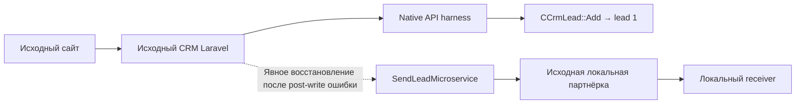

# Native Bitrix lab

Фактический результат и ограничения: [STATUS.md](STATUS.md).
Архитектура и guardrails: [BOOT_PLAN.md](BOOT_PLAN.md).
Штатная trial-установка: [TRIAL_INSTALL_PLAN.md](TRIAL_INSTALL_PLAN.md).

Текущий ID1 создан настоящим API, прочитан native ORM/UF и доставлен локальному
receiver через исходную партнёрку (sentHTTP200). Ветка отправки после ошибки
подтверждения восстановлена отдельно; автоматический handoff с первого запроса
не заявляется. Customer receiver с robots и production настройки не включены.

Существующий runtime возобновляется с `official.compose.yaml`, без install overlay.
Для первого нового scope `prepare_official.py` проверяет официальный archive hash,
`apply_official.py` создаёт только новые собственные ресурсы. Штатный мастер
использует дополнительно `official-install.compose.yaml` для RW webroot;
после установки overlay удаляется из команды, source снова RO.

Не повторять provision или wizard поверх нынешнего scope. Не удалять volumes.
Секреты только в ignored `official-trial/runtime-v1/native.env`, значения не
переносятся в документацию. Тестовые задания выполняются по одному на явно
выбранных очередях; общего worker/cron нет.
