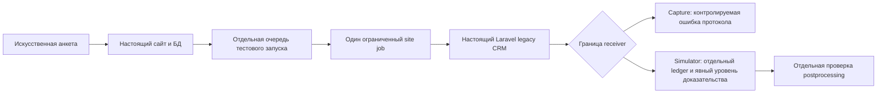

# ADR-0002: Искусственные данные и отдельный приёмник для локальных интеграционных тестов

- Статус: принято для локальной лаборатории; реализация и проверки поэтапные
- Дата: 06.11.2026
- Область: dev/mbk-local; production, бизнес-код MBK_v4 и исходники заказчика не изменяются

## Основание

Пользователь подтвердил отсутствие готовой обезличенной базы Битрикса и рецепта
её запуска. Сайт, Laravel CRM и партнёрка уже работают в изолированной сети.
Первый site job получил HTTP 500 из-за отсутствующей crm.b_user_group.
Ядро и установочные SQL есть в Git; из этого не следуют настройки UF, групп,
справочников, автоматизаций и кампаний конкретной установки МБК.

Настоящий Bitrix receiver вызывает CCrmLead::Add, workflows и robots.
Reader-fixture классификатора не является его полноценной базой. Простой insert
с выдачей leadID нельзя представить как исполнение Bitrix API.

## Решение

Продолжаем проверку настоящих трёх приложений на явно искусственных данных.
Каждый результат получает уровень доказательства:

| Уровень | Что реально выполнено | Что из этого не следует |
|---|---|---|
| native_apps_reader | Настоящий HTTP/ORM/классификатор на локальных fixtures | Production rules, Bitrix creation, доставка |
| native_apps_pre_receiver | Настоящий site job и legacy CRM дошли до границы receiver | Корректная работа Bitrix core |
| protocol_simulation | Настоящие приложения обменялись запросами с отдельным simulator | Выполнение CCrmLead::Add, роботов, договор или оплата |
| genuine_bitrix_runtime | Реальный core/CRM/receiver на совместимой тестовой базе | Production parity без отдельной сверки метаданных |

Уровень genuine_bitrix_runtime сейчас не достигнут. Нужные таблицы ORM берём
из установочных SQL/моделей, данные создаём искусственные. CREATE IF NOT EXISTS
не заменяет проверку схемы: несовпадение колонок/ключей приводит к остановке.
Fixtures не меняют существующие неизвестные записи и не очищают старую очередь.

Если нужен успешный ответ на границе receiver, используем отдельный сервис
с evidence_level=protocol_simulation, собственным хранилищем и локальным URL.
Его идентификаторы относятся к этому хранилищу, а не к настоящему Битриксу.
Выдача ID возможна только после подтверждённой записи в ledger. Повтор операции,
время дедупликации и created должны соответствовать выбранному тестовому
контракту; тестовые значения не объявляются боевыми настройками.

## Поток и критерии проверки

Создание записи, created=false, consent/CPA, постобработка, партнёрская доставка
и бизнес-исход проверяются раздельно. При created=false досрочный возврат не
доказывает прохождение ветки создания и последующей отправки.

Критичные проверки: несовместимая схема; отказ/таймаут receiver; повтор операции;
две конкурентные операции; повтор после рестарта simulator; сбой записи ledger;
несогласованный/неполный ответ; различие flags/очереди/HTTP receipt.
Отдельный случай — HTTP 500 с телом, похожим на успех: текущий Bitrix24Api::send
разбирает JSON без проверки HTTP status. Такой результат не объявлять успешным
протокольным подтверждением, даже если приложение приняло тело за успех.
Артефакт хранит actual state и результаты assert, а не только ожидаемые значения.

## Изоляция и восстановление

Все runtime остаются в проверенной internal сети, без host ports, исходящего
proxy, host socket и production ключей. Новый сервис проходит независимый
review конфигурации и runtime probe до тестов. Обычный браузер Windows не
используется для приложения без отдельного ограничения frontend-запросов.

Старые три pending и одно failed site-задание сохраняются. Новые тесты используют
отдельную очередь и собственные записи; continuous workers/cron не запускаются.
Повтор запуска не превращается в обработку старой очереди. Выключение стенда
через compose down сохраняет volumes; переключение с simulator не запускает
production receiver автоматически.

## Ограничения

Тестовые fixtures и simulator повышают воспроизводимость контрактных тестов,
но не подтверждают текущие условия/кампании, реального покупателя или юридическую
применимость процедуры. Реальные параметры frozen/duplicate/hands/delay остаются
неизвестными. Полноценный Bitrix bootstrap остаётся отдельным уровнем работы,
который можно продолжить по коду и согласованным тестовым метаданным.

Текущее исполнение и проверки: [STATUS](../../dev/mbk-local/STATUS.md).
