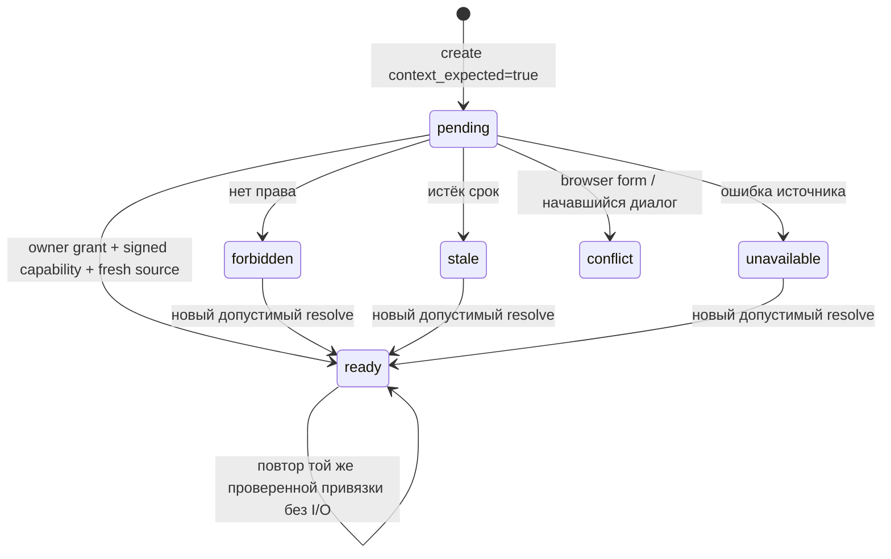

# ADR-0004: Подтверждённая текущая анкета в чате

Дата: 06.11.2026. Статус: принято для локального первого этапа; production
выключен. Связано с ADR-0003 и планом `2026-11-06-sites-debt-onloader.md`.

## Задача и границы

Бот должен использовать уже заполненные сведения текущего обращения, сохраняя
право клиента на доступ к ним. Телефон, form-id и URL из браузера сами по себе
такого права не подтверждают. CRM lookup по телефону возвращает ограниченную
историю, а не текущую анкету и не доказательство отсутствия прежних обращений.

Первый этап — получение текущей анкеты и безопасное использование её фактов
в чате. Это не долговая policy и не разрешение создать/передать лид. Для каждой
сессии нового типа доставка удерживается независимо от результата чтения.

## Контракт и компоненты

| Компонент | Ответственность |
|---|---|
| `customer_context/contracts.py` | Строгие типы ссылки, текущего snapshot и отдельной истории CRM |
| `customer_context/capability.py` | Подписанная связь session/application/subject/revision, audience, TTL |
| `customer_context/service.py` | Проверка подписи, источника, активности и свежести до выдачи handle |
| `customer_context/crm_lookup.py` | Необязательная история по телефону только из авторизованного handle |
| `customer_context/budget.py` | Межпроцессный бюджет запросов на одном SQLite ledger |
| `context_attachment.py` | Привязка формы к пустой сессии, идемпотентность и безопасные ошибки |
| `context_projection.py`, `pii_masking.py` | Закрытая проекция для LLM/public и маскирование известных ПД |
| `context_policy.py` | Общий запрет отправки для всех состояний нового сценария |
| `main.py` | Owner cookie, ограниченный HTTP envelope, session lock, composition root |

Проверенный backend МБК устанавливает владельца обращения и выпускает capability
с отдельным ключом не короче 32 байт. Публичного issuer endpoint нет. Capability
не содержит телефон/ответы; максимальный TTL — 300 секунд. `ApplicationSource`
самостоятельно читает авторитетный snapshot по проверенной ссылке. `observed_at`
означает время такого чтения, а не дату рождения старой формы. Snapshot должен
быть активным, совпадать по application/subject/revision, не быть из будущего и
быть моложе 300 секунд. После медленного чтения право проверяется повторно.

В `AuthorizedApplication` остаются приватные контакты, поля и срок авторизации.
`to_anketa()` проходит существующую нормализацию фактов. `desired_amount` не
превращается в долг; отсутствие авто/дохода/согласия не превращается в false/0.
Snapshot не заменяет контракт согласия, доставки или связи с уже созданным лидом.

## Состояния и HTTP

`POST /api/session` принимает `context_expected: true` и сохраняет pending до
получения данных. `POST /api/session/{id}/context` принимает только capability;
тело ограничено 8 KiB, значение — 4096 символами. Валидация не отражает секрет
в ответ. Существующий подписанный owner cookie обязателен даже оператору.
Started dialogue, browser anketa и начавшийся CRM workflow не перетираются.

Привязка сохраняется как session-bound HMAC digest без исходных идентификаторов.
Повтор требует валидную capability той же привязки, не читает источник и не
тратит lookup. Другая заявка отклоняется до I/O; неверный токен не понижает ready.
Pending/error не запускают обычную анкету в обход ошибки. Отмена HTTP-клиентом
не освобождает turn lock до окончания оставшегося executor worker.

Lock гарантирует сериализацию внутри одного процесса. Межпроцессный CAS для
неизменяемой привязки ещё не реализован; PostgreSQL save текущей сессии его не
заменяет. Production/blue-green для нового сценария этим этапом не разрешён.

## История, privacy и ошибки

История CRM не объединяется с текущими фактами и не передаётся модели. Её ошибка
не стирает уже полученную текущую анкету. Наружу выходят только закрытые статусы;
пустой ответ означает `not_found_or_outside_coverage`, а не «новый клиент».

В LLM/public проекцию входят только нормализованные matrix money/int/bool/enum
и признак известного телефона. Свободные строки из формы не становятся prompt:
имя, контакт, адрес, дата рождения и произвольный текст туда не попадают.
Оригинальные известные ПД маскируют историю и новую реплику ДО удаления raw facts.
Это обязательно даже при выключенном общем PII flag. Приватные нормализованные
факты остаются в серверном session storage для продолжения диалога; capability,
исходная reference и дерево CRM там не сохраняются. Доступ к storage остаётся
серверной обязанностью, а модельная проекция не является анонимизацией базы.

Lookup имеет отдельный opener без proxy/redirect, один запрос без retries,
timeout до 10 секунд и ограниченный ответ. Бюджет резервируется до HTTP через
SQLite BEGIN IMMEDIATE: 100 запросов за скользящие 24 часа на общий файл.
Timeout/ошибка не возвращают квоту. Это бюджет наших клиентов, а не управление
чужими потребителями общего upstream лимита. Кэш успеха ограничен TTL capability
и свежестью snapshot; 429/ошибки не кэшируются как отсутствие истории.

## Delivery gate, включение и откат

Наличие ключа `customer_context` с любым значением удерживает обычную, полную и
отложенную отправку, workflow и site consent. Прямой coordinator submit также
проверяет hold до mapping, claim/IN_FLIGHT и HTTP. Готовая форма не даёт consent.

Composition root должен явно инжектировать `CurrentContextService`; один flag
не создаёт backend. Runtime допускает этап только при одновременно выполненных
условиях: `MBK_CURRENT_CONTEXT_ENABLED=1`, service задан,
`MBK_CRM_LEAD_INTAKE_ENABLED=0`, mock delivery включён. По умолчанию сервис не
подключён. Production lookup, отправки, frontend/onloader и source issuer этим
этапом не включены. Откат: отключить flag и injection; сохранённые context-сессии
остаются held и не превращаются автоматически в обычные доставляемые заявки.

## Проверка и оставшиеся зависимости

Приёмка использует настоящий FastAPI/session/coordinator и перехватывает actual
conversation/extraction model messages. Network-зависимости заменены только
на границе; положительные контроли проверяют, что transport действительно
вызывался бы для допустимой legacy-сессии. Источник исполняемых мутационных
проверок: `evaluation/site_context_guard_mutations.py`. Боевые диалоги читаются
только read-only агрегатами, без экспорта реплик или идентификаторов.

До live нужны реальные ownership/source/issuer API МБК и контракт revision,
межпроцессный CAS, интеграция их виджета, однозначные consent/delivery owner и
наблюдаемый receipt. Долговая policy и доставка онлоадера — следующие отдельные
этапы; местный mock/native прогон не подтверждает production-настройки МБК.

Реальный `ApplicationSource.fetch` обязан ограничивать сетевой timeout/deadline
внутри адаптера. Проверка expiry после fetch отклонит устаревший результат,
но не может остановить зависший произвольный Python callable. Отмена HTTP
сама по себе не прерывает executor thread; без такого ограничения он занял бы
worker и turn lock до окончания вызова.
