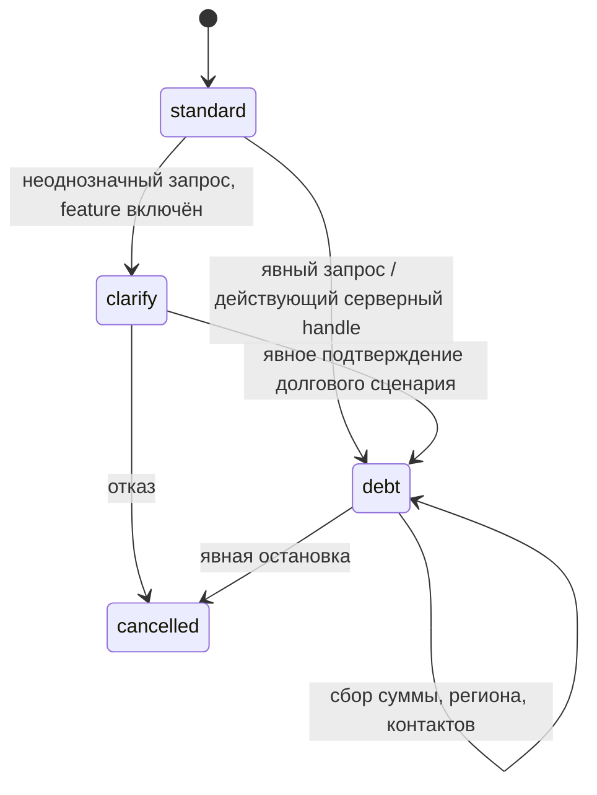

# ADR-0005: Отдельная долговая политика вопросов

Дата: 06.11.2026. Статус: принято для локальной реализации этапа 2.

## Цель и границы

В существующем ядре вводится детерминированная политика списания/реструктуризации.
Она собирает сведения по запросу клиента и использует подтверждённую текущую
анкету. Это локальная консультационная анкета: её исход не является юридической
применимостью банкротства, категорией CRM или подтверждением передачи партнёру.
Коммерческий порог 190000 взят из согласования Михаила/контракта Андрея; значения
реальных кампаний и получателей этой политикой не подтверждаются.

## Состояния и доверие

`questionnaire_policy` хранит версию, режим, закрытую причину и точность ответа
о долге. Право нового входа контролирует `MBK_DEBT_POLICY_ENABLED` (default off).
Принятая policy не исчезает после выключения flag или рестарта. Любое наличие
этого ключа, включая повреждённые данные, удерживает отправку. Отказ не переводит
автоматически в кредит и не снимает hold. Стандартные сессии без policy сохраняют
действующее поведение.

Явный запрос распознаётся по текущей реплике. Одно слово «долг», положительная
сумма, вывод модели, URL, UTM и browser `goal` не подтверждают долговой сценарий.
Противоречивый/неоднозначный запрос уточняется. Доверенный входной сигнал может
создать только адаптер живого `AuthorizedApplication`; извлечение из произвольных
session facts запрещено. Подключение фактического источника МБК остаётся задачей
ADR-0004. Существующие context-сессии не переинтерпретируются по browser goal.

## Разделение ответственности

- `debt_policy.py`: строгие DTO, распознавание входа и суммы, policy-specific Plan,
  local debt bands, безопасные вопросы/завершение. Без env, сети, модели и SQL.
- `debt_workflow.py`: применение policy к session state и согласование результатов
  существующего извлечения фактов с проверенными локальными данными.
- `core.py`: выбор policy до extraction, одинаковая ветка prepare/replan,
  детерминированное отображение вопросов и фиксация состоявшегося хода.
- `main.py`: сохранение hold до запуска worker, HTTP/SSE и public metadata.
- Delivery coordinator/workflow: общий запрет отправки независимо от UI/планировщика.

## Факты и вопросы

Вопросы идут по одному: общая сумма долга, регион, затем отсутствующие контакты.
Известные данные не спрашиваются заново. Возраст, сумма нового кредита, авто,
залог недвижимости и доход не входят в эту анкету. Неполученные значения остаются
неизвестными; существующие подтверждённые факты не заменяются false/0.

Общая сумма долга независима от наличия действующих кредитов. В debt применяется
отдельная derivation без legacy-вывода `no active credits → total=0/history=no_overdue`.
Извлекатель не получает права обнулить долг по этой фразе. Подтверждением новой
суммы служит локально распознанный ответ о сумме, а не сам model fact update.
Диапазон/приблизительность сохраняются отдельно и требуют точного ответа,
даже после повторного уточнения. Нижняя граница не становится точным фактом.

Границы: менее 190000; 190000–299999; от 300000; неизвестная сумма/диапазон.
Это локальные исходы анкеты, без присвоения `sodatech_190`, CRM category,
кредитной истории `ready_bankruptcy` или согласия только из интереса к БФЛ.

Первоначальная версия формулировала вопросы и итог кодом. Решение о речи
пересмотрено 07.11 в ADR-0008, разговорный слой возвращён в новые ветки.
Первоначально LLM оставалась существующим
извлекателем свободных ответов, но не выбирает маршрут или состав анкеты.
Проекция и маскирование не дают частным данным текущей формы стать prompt.
Завершение честно сообщает отсутствие подтверждённой отправки; никаких обещаний
списания, одобрения, доставки или договора.

## Ошибки, наблюдаемость и проверка

Повреждённая/неподдерживаемая policy не открывает standard и доставку. Ошибка
извлечения не снимает ранее сохранённый hold. Backend/source ошибки остаются
в границах ADR-0004. Production не включается и native lab не меняется.

Policy version/reason/phase/band фиксируются отдельно от CRM qualification и
доставки; суммы и контакты не нужны в техническом событии. Приёмка включает
actual prepare/replan/commit/SSE, legacy/semantic extractor, восстановление,
late flag off и прямые full/abandoned sinks с положительными контролями.
Изолированные source mutations проверяют вход, пороги, точность суммы,
сохранение неизвестного, отсутствие лишних вопросов и неизменность hold.
Перед завершением обязательны штатные Ruff/Pyright/Pytest и независимый критик.

## Следующие зависимости

Мобильная поверхность и интеграция виджета проверяются отдельно. Реальная отправка
потребует sender ownership, offer/consent/receipt, reuse существующего обращения
и подтверждённого специального БФЛ-контракта; текущий generic DTO требует SUMM>0
и не заменяет специальную анкету сайта. Успех локальной policy этого не доказывает.

## Страница и явный выбор сценария от 07.11.2026

Основной продуктовый поток — переход в долговую ветку существующего чата МБК.
Страницу `/debt/` Codex подготовил как вспомогательную локальную поверхность.
Она использует рабочую копию виджета сайта МБК.
Кнопка начала консультации или первое отправленное сообщение создают сессию
через `POST /api/session` с `requested_scenario="debt"`. Поле означает явный
выбор открытой анкеты. Сервер проверяет feature flag, сохраняет policy и первый
вопрос о сумме, затем возвращает каноническую историю. Комбинации с `anketa`
и `context_expected` отклоняются до создания сессии. Защищённый snapshot текущего
обращения продолжает получать авторизацию по ADR-0004.

Долговой виджет хранит SID под ключом `mbkDebtChat.sid`, а право доступа получает
в HttpOnly cookie `mbk_debt_session_grant`. Сервер проверяет обе поддерживаемые
owner cookies по подписи конкретного SID. Это позволяет параллельно использовать
обычную и долговую поверхности. Создание нового диалога того же вида обновляет
его cookie. Предыдущая вкладка получает явный отказ и ручные действия восстановления.

Первый вопрос уже входит в ответ создания. Каждый SSE state содержит SID.
После обрыва виджет читает каноническую историю тем же GET. Признак
`turn_in_progress` в ответе GET отражает lock текущего процесса. Три ограниченные
проверки покрывают подготовку ответа. Неподтверждённое сообщение сохраняется
в памяти вкладки как черновик. Подтверждение по текущему SSE либо совпавшей новой
реплике истории очищает соответствующий черновик. Идентификатор/receipt отдельного
сообщения и распределённая обработка остаются в контракте будущей интеграции.

В долговой policy быстрые ответы определяются её вопросами. Текущая версия
возвращает пустой список chips. Bootstrap, восстановление, обычный SSE и
терминальное подтверждение используют одинаковый формат состояния.

## Переход в том же чате от 07.11.2026

На обычной поверхности `/widget/` явный запрос клиента переводит текущую
сессию в debt policy. SID, исходный ключ `mbkAiChat.sid` и нормальная owner cookie
сохраняются. Признак исходной поверхности фиксируется при инициализации,
активный сценарий определяется серверной policy. Переключение применяется к
текущему SSE до обработки старого согласия и отменяет отложенные действия
предыдущего сценария. Новый обычный диалог начинается с обычного сценария.

История и подтверждённые факты сохраняются. Известные имя, телефон и регион
исключаются из плана вопросов. Собственное местожительство, добровольно
указанное вместе с долговым запросом, принимается после локальной проверки.
Город банка, родственника и отрицание города не становятся регионом клиента.
Публичная история проходит существующее маскирование персональных данных.

Однократная миграция снимает старый ожидаемый вопрос и создаёт `debt_script`
с отдельным бюджетом попыток. Исторический `script.attempts` сохраняется.
Автоматический ноль из отсутствия действующих кредитов требует уточнения.
Подтверждённый ноль, значение формы с происхождением и явный ответ о нулевом
долге сохраняются. Одного обозначения `user_explicit` без подходящего текста
недостаточно для признания долга известным.

Любой обрыв потока обычного чата запускает GET той же сессии. Это позволяет
обнаружить долговую policy даже при потере первого state. Восстановление
проверяет SID и тип `turn_in_progress`, применяет каноническую историю.
Ошибка доступа сохраняет идентичность и ручные действия восстановления.
Сохранённый долговой режим защищён от ответа без policy. Повторная отправка
сообщения требует явного действия клиента.

Приёмка проходит через обычный POST без `requested_scenario`, HTTP prepare/SSE,
GET и настоящий виджет. Проверяются оба извлекателя, старые позиции анкеты,
известные контакты, происхождение нуля, регион, восстановление и hold доставки.
Мутации запускаются в неизменяемых копиях. Засчитывается предметное падение
assertion, ошибки запуска и таймауты требуют исправления проверочного теста.

## Уточнение от 08.11.2026

Пользователь подтвердил, что для завершения долговой анкеты обязательно точное
число общей суммы долга. Примерная сумма и диапазон сохраняют неопределённость.
Общие пояснения доступны в том же чате до завершения анкеты. Действующая policy
и hold сохраняются. Это подтверждение текущего контракта завершения.
