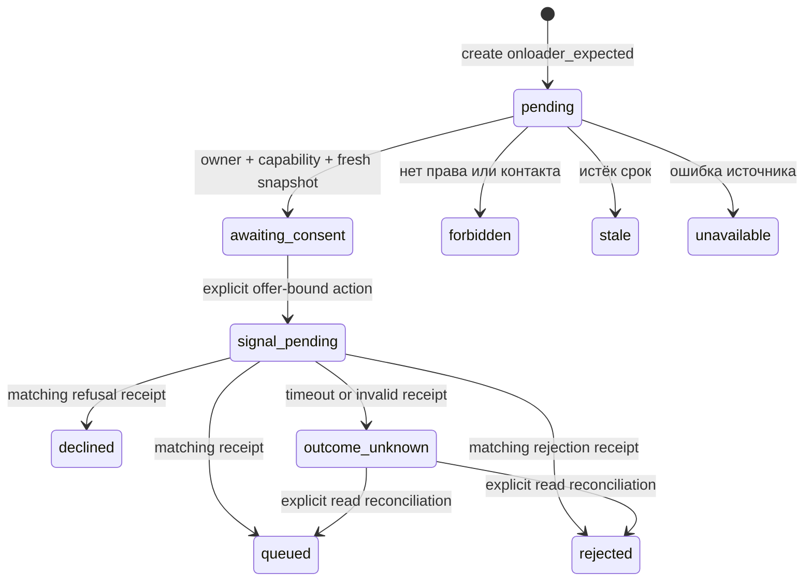

# ADR-0006 — онлоадер в текущем чате с известным контактом

Дата 07.11.2026. Статус принято для локальной проверки с владельцем передачи
`site_backend`. Продуктовая задача Михаила — продолжить существующее обращение
без повторного вопроса о телефоне в текущем боте МБК.

## Основание и границы

В проверенном снимке сайта `GetDataByFormId.php` получает контакт на сервере,
а `LeadsController::sendComebacker` передаёт заявку с источником `onload`.
Текущий путь использует ответы анкеты и создаёт `LeadsDenis`. В нём отсутствует
наш предложенный контракт события согласия, версии предложения и квитанции.
Снимок находится в `logs/local-stack-2026-11-06/sources/project-1/www/`.

Для локальной реализации выбран backend сайта как единственный владелец
передачи. Существует отдельный SQLite-симулятор принятия сигнала. Живая
интеграция с этим backend требует согласования Андрея. Обычная CRM-отправка,
отложенные лиды и прежний `/api/site-consent` для таких сессий удерживаются.

## Компоненты и контракты

| Файл | Ответственность |
|---|---|
| `onloader/contracts.py` | Строгие snapshot, offer, presentation action, command, receipt, private state |
| `onloader/service.py` | Авторизация, привязка к чату, явное решение и чтение результата |
| `onloader/policy.py` | Закрытая публичная проекция, детерминированные ответы и известный контакт |
| `onloader/local_backend.py` | Искусственный источник и SQLite-журнал операций без сетевого транспорта |
| `customer_context/capability.py` | Подписанный session-bound доступ с отдельными ключом и audience |
| `main.py` | Ограниченный HTTP envelope, owner cookie, turn lock и внедрение сервиса |
| `site_widget/_ai-chat.js` | Тот же SID/виджет, host resolver в памяти и кнопки решения |

Snapshot поступает от аутентифицированного backend. В нём находятся закрытые
application/subject/revision, `contact_known`, `delivery_owner=site_backend`,
opaque handle, stable `operation_ref`, конкретное предложение и срок действия.
Телефон не входит в этот контракт. Значение `facts.client.phone` сохраняет
прежнюю семантику реального номера, подставных значений для планировщика нет.

Capability имеет audience `mbk-onloader`, отдельный ключ и TTL до 300 секунд.
Сервис проверяет подпись, SID, возраст snapshot, активность и известный контакт.
Snapshot перепроверяется до принятия решения. Локальный backend повторно
проверяет контакт, активность, текущий offer fingerprint и срок авторизации
в момент фиксации команды. Адаптер будущего backend обязан ограничивать свой
timeout внутри каждого вызова, отмена HTTP не прерывает Python executor.

## HTTP и переходы

`POST /api/session` поддерживает `onloader_expected=true` с прежним обычным
SID и owner cookie. Hold сохраняется до обращения к host resolver.
`POST /api/session/{id}/onloader` принимает только capability. Он также может
привязать подтверждённый контекст к уже начатому обычному или долговому чату,
сохраняя историю, факты и счётчики. Привязка другой формы, browser anketa,
уже начатая CRM-поставка и смешение с ADR-0004 отклоняются.

`POST /api/session/{id}/onloader/decision` принимает решение accept/decline,
presentation ID и точные offer ID/version/consent version. Сообщение «да»,
долговой запрос, загрузка страницы и GET согласие не создают. Текст согласия
показывается детерминированно с получателем, целью консультации и версией.
Юридическая формулировка и техническая точка живого согласия остаются за МБК.

Перед передачей сигнала в состоянии сессии фиксируются событие, решение, время,
presentation и срок авторизации. Повтор такого же действия возвращает текущее
состояние, противоположное решение отклоняется. Нет автоматической повторной
команды после таймаута. `POST /api/session/{id}/onloader/reconcile` только
читает backend-квитанцию и сверяет все поля исходной команды. Подтверждённая
очередь сохраняется при последующей ошибке чтения. `queued` означает локальную
очередь сигнала, принятие клиента и доставка компании требуют отдельного учёта.

Свежая capability той же привязки может продлить право чтения результата,
сохраняя event, presentation, offer и решение исходной операции. Новый nonce
или версия предложения не обнуляют спорную операцию. Истёкший доступ требует
подтверждения через host сайта.

## Идемпотентность и восстановление

SQLite использует `BEGIN IMMEDIATE` и уникальный backend `operation_ref`.
Он стабилен между SID, вкладками, event ID и версиями предложения. Замороженная
команда сравнивается полностью. Симулятор возвращает прежнюю квитанцию для
точного повтора и отклоняет конфликтующий payload. Журнал хранится вне repo,
повторная инициализация backend использует тот же файл.

Session turn lock сериализует изменения одного процесса и удерживается до
окончания worker даже при отмене HTTP. Полный CAS состояния сессии между
несколькими ASGI workers остаётся условием production-интеграции по ADR-0004.
Локальная приёмка привязки использует один процесс. Межпроцессная уникальность
операции проверяется отдельно на общем SQLite-журнале.

В исходном preview без `--state-dir` приватная сессия хранится в памяти. `SessionStore.persist` сохраняет
маскированную диагностику и использует best-effort запись repository, ошибки
которой поглощаются. Его возврат не подтверждает durable commit намерения.
Устойчивым компонентом этого этапа является SQLite-журнал команды получателя.
Тест сериализации `Session.storage_record`/`Session.from_record` проверяет
восстановимость структуры, тест повторного открытия SQLite — журнал backend.
Фактическую запись сессии при отказе repository они не подтверждают.
Перед подключением любого сетевого sender обязателен отдельный durable intent
journal или подтверждённый commit storage перед I/O. Этот gate дополняет CAS.

Надёжный локальный режим от 07.11 реализован в ADR-0007. Он подключает SQLite
sessions, typed commit ACK, полную revision/CAS и стабильные ключи. Критические
операции онлоадера требуют `persist_durable`. Сетевой production sender и
строгий Postgres adapter остаются отдельным этапом подключения.

## Текущий бот и privacy

Host resolver получает фактический SID и возвращает capability в память
виджета. Токен не попадает в URL, DOM, localStorage или историю. Reload читает
состояние той же сессии, незавершённая передача восстанавливается чтением.
Backend offer карточка и действия живут внутри текущего виджета.

Для обычного онлоадера ответы фиксированы и не запрашивают контакт. По запросу
клиента может продолжаться прежняя долговая консультация с отдельной policy.
В её основной и запасной планировщик передаётся подтверждённый `contact_known`.
Готовое предложение backend опирается на его текущую анкету. Полнота вопросов
бота не присваивает ему CRM-категорию и не подменяет решение владельца оффера.
Согласие по предложению всегда обрабатывается отдельным действием.

Вся приватная onloader-структура исключена из LLM, диагностического snapshot
и публичного состояния. В UI выводятся закрытые статусы, offer labels и
presentation ID. Серверное хранилище содержит краткоживущий opaque handle для
восстановления. Это credential серверного контура с ограниченным TTL, его
защита, хранение и отзыв относятся к backend-интеграции. Значения credentials
и исходные идентификаторы не включаются в отчёты и технические события.

## Включение, наблюдаемость и приёмка

Сервис явно внедряется composition root. Нужны одновременно
`MBK_ONLOADER_LOCAL_ENABLED=1`, mock delivery и выключенный CRM lead-intake.
Отключение flag сохраняет hold уже созданных сессий. Боевой HTTP sender
в этом этапе отсутствует.

Приёмка использует реальные HTTP/SSE, публичную проекцию и текущий виджет.
Проверяются source/owner/offer expiry, происхождение известного контакта,
согласие, отсутствие повторных вопросов, restart, два SID, двойной клик,
таймаут до/после фиксации и сопоставление квитанции. Мутации запускаются на
копиях и засчитываются по предметным assertions. Сохраняются версии контрактов,
хеши проверенного кода и артефакты тестов вне repo. Локальные метрики включают
число операций, статусы решений и неизвестных исходов, без персональных данных.
