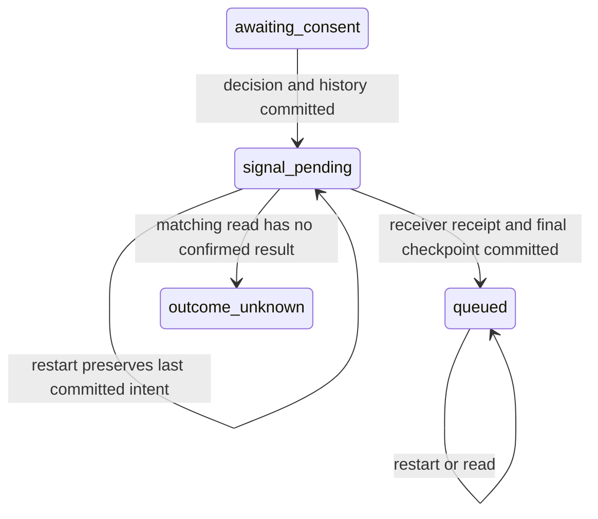

# ADR-0007 — устойчивые локальные сессии и решения

Дата 07.11.2026. Статус принято для локального SQLite-режима текущего бота.
Задача пользователя — сохранять сессии и решения после перезапуска с локальной
проверкой через агентов и независимого критика.

## Структура модулей

| Файл | Ответственность |
|---|---|
| `storage/sessions.py` | Совместимый record, revision, ACK и интерфейс committed repository |
| `storage/sqlite_sessions.py` | Локальная схема, транзакция, CAS и подтверждение COMMIT |
| `session_store.py` | Кэш, строгая запись, чтение committed snapshot и обновление под блокировкой |
| `onloader/service.py` | Атомарное решение с историей и ACK перед receiver |
| `onloader/local_backend.py` | Сохранённый источник авторизации и журнал команды receiver |
| `main.py` | HTTP/SSE ошибки и повторная проверка после ожидания turn lock |
| `site_widget/stand/debt_preview.py` | Постоянный локальный state-dir, ключи и изолированный runtime |

## Контракт записи

Прежний `SessionStore.persist` рассчитан на best-effort запись и сохраняет
свою совместимость для существующих repository. Новый режим включается явно
через `SessionStore(require_durable=True)`. Критические операции онлоадера
используют `persist_durable` и требуют подтверждение записи независимо от флага.

`SessionCommit` содержит SID, следующую целочисленную revision и SHA-256 полного
сериализуемого record. В digest входят история, факты, анкета, usage, timestamps
и признак открытия. Revision хранится отдельно. Runtime-ключи верхнего уровня
с подчёркиванием исключаются, персональные факты сохраняются в приватном storage.

`SQLiteSessionRepository.save_committed` проверяет ожидаемую revision,
выполняет транзакцию с `BEGIN IMMEDIATE` и `synchronous=FULL`, затем возвращает
подтверждение после COMMIT. `SessionStore` проверяет тип и содержание ACK,
а `OnloaderService` отдельно связывает его с текущим состоянием и revision.
Нулевой результат, неверный digest, другой SID и bool вместо revision отвергаются.

В SQLite обычная запись устаревшего полного record отклоняется. Изменение
принадлежащего БД состояния CRM требует отдельного owner-write. Захват lead
слота проверяет revision и сохранённые holds в той же транзакции, его новая
revision возвращается в store. Перезапуск reader/worker не обнуляет эти условия.

## Переход решения и сбои

Решение, неизменяемые event/presentation/offer, срок авторизации и текст действия
клиента записываются одним checkpoint до вызова receiver. Итог и ответ бота
также записываются вместе. Ошибка записи до ACK прекращает выполнение до
receiver. Подтверждение receiver при отказе финальной записи оставляет в БД
исходный `signal_pending`, который восстанавливается для ручной сверки.

При неясном результате записи горячая копия помечается uncertain. Её следующее
использование требует загрузки из хранилища. Ошибка чтения даёт ограниченный
503, конфликт — 409. Ответ хранилища с ошибкой не превращается в новую сессию.
SSE после отказа записи возвращает ошибку без утверждения нового состояния.

В надёжном режиме GET возвращает отдельную копию последнего committed record.
Признак `turn_in_progress` относится к активному worker. Незавершённые изменения
его памяти и истории не объявляются каноническими до ACK.

Запрос, ожидающий turn lock, повторно проверяет committed record после
получения блокировки. Это относится к онлоадеру, привязке контекста и SSE,
включая пустой opening. Ошибка предыдущего worker не даёт ожидающему запросу
подтвердить его несохранённое решение из общей горячей копии.

После старта и GET отправка не запускается. Для `signal_pending` и
`outcome_unknown` остаётся отдельная ручная операция чтения результата.
Ключ SQLite receiver — стабильный backend operation ref, исходное событие
и payload сохраняются. Другая попытка не создаёт вторую операцию.

## Реальное восстановление локального стенда

`site_widget/stand/debt_preview.py --state-dir <private-directory>` подключает
SQLite sessions, строгую запись и restore при старте. Папка находится вне repo.
Диагностика размещается внутри неё и содержит маскированный snapshot.
Приватный record восстанавливается только из sessions storage.

Ключи owner grant и onloader capability создаются один раз в приватном файле
через exclusive create и fsync. Существующий повреждённый файл блокирует запуск
вместо незаметной смены ключей. Значения не входят в source manifests, логи,
отчёты, URL или публичный список assets.

`LocalOnloaderBackend` сохраняет исходные source snapshots и opaque handles
в отдельной таблице своего SQLite-файла. Observed/expiry/active/revision после
старта сохраняют исходное значение. Новый срок появляется только при явном
подтверждённом обновлении через host fixture. Реальный внешний issuer остаётся
зависимостью backend МБК по ADR-0004 и ADR-0006.

## Совместимость и границы

Для старых `SessionRecord` revision по умолчанию равна нулю. Обычная совместимая
работа прежнего Postgres adapter сохраняется. Строгий ACK/CAS этого этапа
реализован и проверен для локального SQLite. Production Postgres потребует
своей миграции revision, ACK/CAS adapter и приёмки перед включением нового режима.
В этом этапе production DSN, миграции production и отправки не запускаются.

SQLite схема имеет собственный version marker. Файлы нового локального режима
создаются отдельно от прежних каталогов preview и native lab. Библиотеки
добавлять не потребовалось. Private state/key bundle принадлежат локальному
пользователю, шифрование и эксплуатационная политика production остаются
за инфраструктурой развертывания.

Проверки включают настоящие дочерние процессы Uvicorn, принудительную остановку
и новый PID с тем же каталогом и исходной cookie. Проверяются обычный и долговой
диалоги, исходный вопрос, contact-known онлоадера, queued/pending и source expiry.
Fault cuts стоят до ACK, после ACK до receiver и после receiver COMMIT до
финальной записи. Дополнительно проверяются отказ storage, реальная SQLite
блокировка, неверные ACK, stale writers и privacy.

Сценарии отказа файловой системы проверяются через ошибки и блокировки.
Они не являются испытанием физической потери питания, репликации или HA.
Внешние модельные сервисы и коммерческая доставка в локальном стенде заменены
на границах. Репозиторий и reports сохраняют версии контрактов и source hashes.
