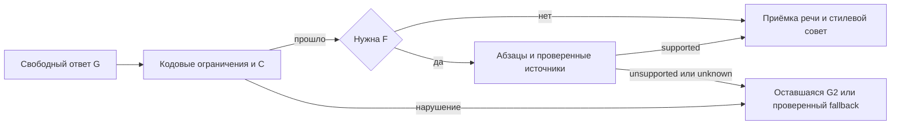

# ADR-0009. Семантика разговорного выбора и утверждений

Дата 08.11.2026. Статус в реализации, локальная калибровка и приёмка открыты.

## Основание

Полные разговоры V11 выявили пропущенный разговорный отказ, вымышленную
зависимость сохранения ответов от телефона и необоснованное утверждение об
отсутствии у компании других контактов. Лексические проверки V18 проходили.
Широкие стилевые флаги не предоставляли проверяемого контракта этих смыслов.

## Контракт и переходы

Код формирует неизменяемый TurnAuthority из текущего DialogueFrame.
Последнее маскированное сообщение и окончательный маскированный ответ имеют
собственные хеши. Приватные идентификаторы предложения остаются в backend.
Перед применением выбора backend дополнительно сравнивает полную приватную
карточку с захваченной до генерации. Хеш публичного frame не заменяет эту проверку.

Поток G1 → C1 → проверка кодом → при необходимости G2 → C2 → commit → publish.
Максимум две речевые генерации и два анализа. C1 выполняется также для
черновика, отклонённого детерминированными проверками.

Анализ содержит независимые каналы пользовательского выбора, утверждений
ответа и стилевых замечаний. Кандидаты имеют закрытые типы, точное evidence,
модальность и область действия. Код сверяет их с текущим контекстом.
Исходящие просьбы о телефоне и согласии представлены отдельными speech_acts.
Условная формулировка зависимости общения или сохранения от телефона также
проверяется как зависимость. Цитаты и вопросы о такой зависимости сохраняются.
Отказ относится только к разговорному предпочтению текущего предложения или
сбору контакта. Формальное согласие и отправка управляются прежним протоколом.

При недоступном разборе выбора сохраняется отдельная пауза. Она подавляет
давление, сохраняя неопределённость выбора. Подтверждённый отказ сохраняется
независимо от пригодности речевого черновика. При непроверенных утверждениях
используется ограниченный фактический fallback. Стилевые замечания advisory.

Ответ policy-ветки публикуется после подтверждённого сохранения истории и
разговорного состояния одним CAS. Отключение клиента не освобождает turn lock
до завершения фонового commit. Обычный legacy streaming сохраняет свой путь.

## Область и стоимость

Новый путь включается MBK_POLICY_SEMANTIC_ENABLED, по умолчанию выключен.
Локальная проверка включает его явно. Production-конфигурация не меняется.
Используется существующая отдельная модель извлекателя. Лимит анализа
увеличен с 300 до 1000 output tokens для структурированного контракта.
Число вызовов не увеличивается относительно максимума 2G+2C.
Таймаут транспорта не гарантирует физический wall-clock deadline.
В V14 фазовый бюджет анализа увеличен с 6 до 10 секунд после наблюдённого
валидного ответа за 7,649 с, отклонённого прежним лимитом. Это перспективное
изменение. Прежний результат остаётся ошибкой своей серии. Общий deadline
30 с в проверках и до 40 с в runtime ограничивает каждую оставшуюся фазу.
Максимальные фазовые лимиты всех четырёх вызовов одновременно не гарантируются.

## Проверка и ограничения

Нужны контрастивные примеры пользовательского отказа, цитат, условных фраз,
чужих решений и других операций. Отдельно проверяются ложные цели контакта,
статусы действий, маскирование, сбои, CAS и отключение клиента.

Точная цитата доказывает происхождение evidence. Она не доказывает правильность
семантической классификации. Заполненная матрица покрытия и пустой список claims
также не доказывают полноту извлечения. Эти риски оцениваются размеченным
корпусом и независимым чтением полных диалогов. Стилевую приёмку нельзя заменить
прохождением контрактных тестов.

Повтор непустого HTTP-запроса пока не имеет клиентского turn_id. Exactly-once
воспроизведение такого запроса данным решением не гарантируется.

## Уточнения V15

Разбор модели принимает исходный JSON-объект и один полный JSON-блок Markdown.
Внешняя обёртка нормализуется общим чистым декодером. Лимит исходных 16 КБ,
проверки ключей, повторов, nonfinite, типов и evidence сохраняются. Проза вокруг
объекта, несколько блоков и незакрытая обёртка отклоняются.

Для цели ответа хранится происхождение code либо model_hint. Все ограничения
сбора, проверки суммы, содержания и обязательной цели используют только
trusted_question_goal. Подсказка модели направляет генерацию и остаётся подсказкой
при повторной оценке C2. Она не отменяет требуемый вопрос и не ослабляет guard.
Нейтральный fallback сообщает asked_field=None. История вопросов и попыток
отражает действительно озвученный вопрос.

Development replay прошёл 26 прежних примеров. На свежих 12 осталось одно
расхождение asserted/conditional. Запрет ложного условия про телефон сработал,
но строгий результат 11/12 остаётся неуспешным. Для поиска ошибок и оценки живой
речи отдельно разрешён диагностический прогон 11 разговоров на тех же исходниках.
Это перспективное исключение из порядка приёмочных запусков. Общая приёмка
остаётся закрытой, failed holdout сохраняется и в PASS не превращается.

## Восстановление V16

Диагностические 11 разговоров V15 прочитаны полностью. Обнаружены потеря ответа
на долговой FAQ, ложные срабатывания классификатора на корректное название
получателя и назначение телефона, неподтверждённая возможность соединения с
менеджером после передачи и повторные нейтральные ответы при задержках.
Эти результаты сохраняются. Классификатор, gold и модель в этой правке не меняются.

Повторная генерация получает реальные закрытые причины отказа детерминированной
проверки содержания, точности суммы и разрешённого сбора. Раньше эти причины
заменялись общим hard_contract, и модель повторяла ту же ошибку.

Фактический fallback для доверенного долгового FAQ объясняет реструктуризацию
потребительского кредита и условность освобождения от обязательств. Область
определения ограничена договором потребительского кредита. Судебная
реструктуризация в банкротстве этим определением не исчерпывается.
Эта часть опирается на вопрос 71 от 04.03.2024, проверенный 08.11.2026.
[Разъяснение Банка России](https://www.cbr.ru/explan/359-fz/)

При пригодной актуальной карточке запасной ответ может назвать её публичного
получателя и консультационное назначение. Прямой вопрос об этом можно объяснить
и после разговорного отказа. Подсказка выбирает только готовые факты карточки,
её происхождение model_hint сохраняется. Простое «нет» сохраняет нейтральный
ответ, а неразрешённая пауза исключает автоматическое пояснение карточки. Подсказка модели не подтверждает
эти сведения. Их подтверждает карточка backend. Формальные решения, отправки,
будущие звонки и исключительность обработки из этого не следуют.

При валидном C2 устраняется неопределённость, введённая C1 этого же хода.
Пауза, пришедшая из сохранённого состояния, сохраняется. Валидная интерпретация
C1 также сохраняется при недоступном необязательном C2. Решения о формальном
согласии и доставке остаются в прежнем контуре.

Общее правило доступности исправлено в исходном системном промпте. Теперь оно
учитывает явно переданные сведения текущего обращения и не обещает появление
функций после передачи. STYLE_EXAMPLES и CONVERSATION_VOICE сохранены.
При сравнении с исходным AST отдельно нормализуется только изменённый блок 1a,
наряду с прежними исключениями. Исходные хеши сравнения сохранены, новое правило
проверяется отдельными утверждениями и через сборку реального model payload.
Все 11 разговоров V16 завершены и прочитаны. Ручная приёмка не пройдена.
Обнаружены два ложных разговорных отказа, превращение условного выбора суммы
в точную и оставшиеся сухие повторы. Исходные результаты сохранены.

## Уточнение переходов V17

Для короткого отказа важен объект последнего вопроса. Код формирует reply_target
по актуальному backend-вопросу о передаче либо по последнему реально озвученному
вопросу о телефоне. Наличие активной карточки или более ранней просьбы о контакте
само по себе такой объект не устанавливает. Предыдущая реплика помощника передаётся
анализу маскированной и ограниченной последними 2000 символами. Evidence акта
по-прежнему берётся только из последнего сообщения клиента.

Редьюсер дополнительно требует признаки отрицания или отказа и ссылку на свою
операцию в той же клаузе. Короткое отрицание без ссылки допустимо при совпавшем
кодом объекте предыдущего вопроса. Отрицание возражения или отказа не считается
самостоятельным отказом. При явно названной другой операции объект предыдущего
вопроса не подставляется. Необоснованная модельная метка оставляет решение
неустановленным и включает отдельную паузу. Эти условия ограничивают применение
меток, полного доказательства понимания языка они не дают.

Сравнение текста backend-вопроса с историей не создаёт нового доказательства
приватного идентификатора прежней презентации. Существующая проверка полной
приватной карточки при генерации и commit сохраняется.

Число, выбранное условно через «пусть будет», «будем считать» и аналогичные
числовые конструкции, сохраняет неопределённость. Общая числовая конвертация
parse_amount не меняется. Для завершения анкеты по-прежнему нужен собственный
точный остаток долга. Сумма не становится точной из-за предложения помощника.

Завершение разговора ограничивает новый сбор, вопросы и кнопочные приглашения.
При повторе дословного ответа допустима одна рекомендательная перегенерация.
Проверенный первый ответ сохраняется, если необязательная попытка не прошла
проверку. Узкое удаление пустой квитанции применяется только к целому пузырю
после доказанного фактического ответа. Эмоции, вопросы и содержательные пояснения
сохраняются. Исходные STYLE_EXAMPLES и CONVERSATION_VOICE не меняются.

Все 11 разговоров V17 завершены. Ручная проверка выявила потерю явного отказа
при недоступности анализа, слишком широкое исключение для возмещения вреда,
неучтённую просьбу назвать сумму и отмену долговой ветки после вопроса об альтернативе.
Прежний HOLD12 strict11/12 остаётся FAILED, метки и критерии не изменяются.

## Восстановление V18 при недоступной модели

До вызова модели код извлекает только однозначный собственный отказ от контакта
или текущей передачи. Короткое «нет» требует установленного объекта последнего
реального вопроса. Цитаты, чужие решения, вопросы и гипотезы исключаются.
Разговорный отказ применяется даже при недоступности генерации и анализа.
Он сохраняется вместе с завершённым ходом через существующий CAS. Сохранение
до окончания модельного вызова или при аварии процесса этим не гарантируется.

Остальные формулировки проходят прежний типизированный анализ. Подтверждение,
формальное согласие и доставка из детерминированного отказа не выводятся.
В диагностике отдельно записаны code_user_acts и модельные акты. Успешную
кодовую защиту нельзя засчитывать как верную классификацию модели.

Общий last_collection_field определяет последний фактически озвученный вопрос.
Его используют semantic- и legacy-пути. В semantic-режиме ранний legacy-разбор
контактного отказа отключён. Сам по себе старый курсор анкеты не определяет,
на что отвечает клиент. Существующая проверка приватной карточки сохранена.

Доверенная цель offer_recipient отвечает на прямой вопрос о получателе по
актуальной карточке backend даже при недоступной модели и после отказа.
Название компании и цель консультации не подтверждают будущий звонок,
исключительность обработки, согласие или отправку. История не заменяет карточку.

Проверка содержания учитывает конструкции «придётся платить», «нужно погашать»
и аналогичные обязательства. Неуточнённое исключение для любого вреда отклоняется.
Просьба «точную сумму можете назвать?» распознаётся общим контрактом сбора.
Вопрос «можно ли без банкротства?» сохраняет долговую ветку. Однозначный город
из начала той же реплики принимается по существующему каталогу.
Поле точной суммы остаётся обязательным для завершения анкеты.

Исходные STYLE_EXAMPLES и CONVERSATION_VOICE сохранены. V18 прошёл полный
pytest 4697 PASS и один известный пропуск, Ruff/Pyright без ошибок, виджет 117 PASS.
Основной набор мутаций сохранил FAIL 26/27. Отдельный legacy-контроль обнаружил
пропущенный дефект четырьмя assertions. Независимо проверены 30 XML и нулевые
сетевые обращения этих проверок. Повтор 11 полных разговоров зарегистрирован
в v18-resume-20261108/full11-preregister.json, SHA 0c2b0f8e…df2e8.
Все 11 разговоров завершены и полностью прочитаны исполнителем и независимым
критиком. 241 запрос и 241 usage, учтённая оценка $0.359893, отправок ноль.
Остались два дефекта. Примерная сумма ошибочно объявлена достаточной для
продолжения, хотя состояние анкеты осталось unknown. После согласия обсудить
долги повторялось само приглашение. Ручной результат FAIL сохранён.
Новым независимым holdout эта серия не является.
MBK_POLICY_SEMANTIC_ENABLED по умолчанию остаётся выключен.

## Уточнение V19 по незавершённой анкете

Повествовательная квитанция «оставим около 400 тысяч» не является просьбой
сообщить сумму. Общий разбор различает направленные клиенту повелительные
формы и собственное повествование помощника. Совершенные и несовершенные
формы просьб сохранены. Количество в повествовании не создаёт asked_field.

Пока сумма неопределённа, утверждение о достаточности для продолжения или
завершения анкеты отклоняется. Общий разговор и пояснения остаются доступны.
При исчерпании проверки речи запасной ответ сообщает необходимость точной
суммы для завершения и доступность беседы. Новый вопрос ему не приписывается.
Подлинный отказ от телефона или передачи и завершение разговора сохраняют
приоритет. Фактический ответ на вопрос клиента также сохраняется.

Клиент может сам вернуться с точным числом после такого ответа. Существующий
планировщик должен подтвердить недостающую сумму активной долговой задачи,
наблюдение должно быть unknown/range, других заданных вопросов и распознанного
нового телефона нет. Затем применяется прежний разбор суммы. Счётчик вопросов
и история заданных вопросов не изменяются. Возраст, доход, новый кредит,
цитата или условный пример не заменяют собственный остаток долга.

После завершения сбора речевая инструкция требует выполнить уже предложенное
обсуждение по существу. Новое приглашение после согласия не требуется.
Исходные примеры персонажа сохранены. Свежий полный прогон V19 выполняется
после проверок текущих исходников, прежний FAIL V18 остаётся в артефактах.

Текущий полный pytest дал 4768 PASS и один известный пропуск, Ruff/Pyright
без ошибок. Для виджета использовано прежнее подтверждение 117 PASS после
сверки всех 11 исходных хешей. Пять конечных адресных мутационных контролей
дали 23 настоящих падения утверждений, ошибок и сетевых обращений ноль.
Проверены все семь XML и текущие исходники. Это проверка названных регрессий.
Полнота понимания естественного языка из неё не следует.

## Уточнение V20 по фактической точности во время FAQ

Все 11 разговоров V19 прочитаны. Остался один P2 в ответе о назначении суммы.
Коллекция была отложена ради пояснения, и allowed_field=None также отключал
проверку точности. Реплика допускала продолжение с примерной цифрой без явного
разделения общения и завершения анкеты. Данные остались unknown, отправки нет.

Проверка точности теперь использует confirming и expected. Известная текущая
сумма сохраняет прежнее исключение. Разрешение собирать сведения по-прежнему
определяет allowed_field. Запрос «назвать точный остаток» получает тему текущей
суммы и отклоняется во время такого FAQ. Два контракта проверяются независимо.

Двенадцать новых регрессий проверяют исходную реплику, числовые правовые факты,
общий разговор и обычный prepare/render/commit. Промежуточный полный прогон
выявил потерю исключения для известной суммы. Оно восстановлено, прежний тест
сохранён. Финальный полный набор дал 4780 PASS и один известный пропуск,
Ruff/Pyright без ошибок. Два адресных текущих мутационных контроля дали четыре
падения assert при baseline 89 PASS, ошибок и сетевых обращений ноль.
Прежние мутации отдельно сохраняют свои версии. Для трёх неизменённых функций
зафиксирована сверка AST. Новым выполнением прежних мутаций она не является.
Повтор всех 11 разговоров V20 зарегистрирован с SHA 8216e1f3…652b8.

## Уточнение V21 по вопросу об альтернативе

В V20 вопрос «А без банкротства можно обойтись?» ошибочно перевёл уже выбранную
долговую ветку в cancelled. Прежнее исключение для вопросов требовало одного
из перечисленных первых слов. Факты и отказ от телефона сохранялись, но цель
обсуждения менялась без собственного отказа клиента.

Выбор существующей policy теперь проверяет собственный отрицательный предикат
в утверждении. Порядок слов вопроса и упоминание альтернативы не доказывают
отказ. Отдельное утверждение отказа и STOP сохраняют прежнее действие. Цитата,
условный пример или чужое решение не отменяют текущую цель. Вход новой сессии
этим изменением не затронут. Это консервативный контракт с ограниченным языковым
покрытием. Понимание любого естественного сообщения не заявляется.

Двадцать четыре новых регрессии и существующие проверки селектора прошли.
Финальный полный набор дал 4804 PASS и один известный пропуск, Ruff/Pyright
без ошибок. Один адресный мутант восстановил прежнюю ошибку. Baseline 226 PASS,
19 настоящих падений assert, ошибок и сетевых обращений ноль.

Для экономии заключительный V21 использует зафиксированные 82 реплики клиентов
из всех 11 завершённых разговоров V20. Бот, анализ и извлечение вызываются заново.
Клиент-актёр отсутствует. Начальные фикстуры сверены при одинаковом времени,
тестовый TTL предложения онлоадера обновляется тем же правилом 300 секунд.
Историческая абсолютная метка времени не воспроизводится. Это парное сравнение
известных сценариев, прежние raw-оценки и неуспешный holdout сохраняются.

V21 завершён, actual EXIT0, AFTERproof 17e2e577…4a55 подтвердил неизменность
исходников. Все 11 разговоров и 82 клиентских сообщения прочитаны исполнителем
и независимым критиком. В этом наборе новых существенных нарушений контрактов
не найдено. Вопрос об альтернативе сохраняет contact_declined_held, точную
сумму 280000 и контактный отказ. Прямое поле final policy.mode регистратор
не сохраняет, вывод о режиме дополнительно опирается на правила policy_phase
и проверку обычного prepare/render/commit.

Три безопасных резервных ответа, лишнее уточнение региона и похожие завершения
отмечены как P3. Один резервный ответ длинный и формальный. Отсутствие этих
замечаний или полная клиентская приёмка речи не заявляются. EXIT0 этого replay
подтверждает выполнение зафиксированных реплик и его защитных условий.
Он не превращает старые hard-eligibility FAIL и HOLD12 в PASS.
Модельный анализ пропустил два отклонённых кодом черновика. Успешную кодовую
защиту нельзя приписывать точности модели. Локальные исправления проверенных
контрактов готовы к дальнейшей интеграции при сохранении существующих границ.

## Уточнение V22 по повторным вопросам и завершениям

Пользователь отдельно поручил устранить три замечания V21 к тону.
Подтверждение географического объекта по сигналам «верно?», «правильно?»,
«так?» или «подтвердите» распознаётся как сбор региона. Объект определяется
существующим локальным каталогом. Известное поле запрещает повтор, неизвестное
остаётся доступным для уточнения. Обычные географические пояснения, вопросы
человека и поправки сохраняются. Внешний геокодер для этого не вызывается.

Повторный пустой хвост с приглашением написать опускается до анализа C.
Проверяется целый заключительный пузырь, наличие полезного ответа перед ним
и аналогичного недавнего приглашения. Используется ограниченная грамматика
речевого действия, готовые клиентские ответы не выбираются из списка.
Числа, конкретные сведения, эмоции, вопросы и прямой ответ о доступности чата
сохраняются. Утверждённый C текст после проверки этим правилом не редактируется.

После завершённого пояснения без нового вопроса пустое «ага» не возобновляет
анкету. При настоящем вопросе учитываются все пузыри последнего хода помощника.
Эмоциональный символ вместе с поддакиванием сохраняет содержательность сообщения.
Основные входы main и execute_core_turn проверяют conversation_is_over до
prepare_turn. Новые флаги и отдельные ветки prepare/stream/commit не добавлены.
История с пустым assistant-сообщением и история только с тихой репликой клиента
обрабатываются одинаково. Незавершённые факты и действующие отказы сохраняются.

Полные проверенные факты RESTRUCTURING_EXPLANATION и BANKRUPTCY_EXPLANATION
сохранены для генерации и ремонта. Только резервный долговой FAQ получает
краткую проекцию, 321 символ и два абзаца. Она сохраняет различие способов,
условность списания, квалифицированные исключения и зависимость прощения долга
от кредитора. Обычная речь продолжает генерироваться исходной моделью.

Все прежние тестовые случаи V21 сохранены. Полный V22 дал 4877 PASS и один
известный пропуск, Ruff/Pyright без ошибок. Четыре адресных текущих мутанта
проверили географию, хвост, тихое поддакивание и краткую проекцию. Baseline
127 PASS, 32 реальных падения assert, ошибок и сетевых обращений ноль.
Проверка естественного языка остаётся ограниченной этим контрактом и корпусом.

## Составление очисток V23

Полный V22 выявил взаимодействие двух правил. Удаление повторного приглашения
оставляло краткое подтверждение города. Последующее удаление пустой квитанции
стирало весь ответ. После двух генераций показывался запасной текст backend,
на двух соседних ходах дословно одинаковый. Остальные основные контракты
в этом прогоне сохранились, но запрос пользователя по трём замечаниям ещё
не был завершён. Этот результат V22 сохранён.

Очистка квитанции теперь применяется, только если после неё остаётся непустой
текст. В противном случае сохраняется короткая исходная реакция модели,
которая затем проходит обычный C и детерминированные проверки. Одобрение не
подставляется, новые клиентские фразы не генерируются кодом. Полезный ответ
по-прежнему позволяет опустить отдельную пустую квитанцию и повторный хвост.

Полный набор V23 дал 4883 PASS и один известный пропуск, Ruff/Pyright без ошибок.
Все тестовые случаи V22 сохранены. Один адресный мутант восстановил удаление
всего текста и дал три настоящих падения assert при baseline 140 PASS.

На 46 сохранённых речевых черновиках из всех 11 разговоров проверено 920
закрытых комбинаций параметров двух очисток. Все 914 прежних непустых результатов
сохраняются побайтово. Шесть изменённых комбинаций относятся к двум черновикам
проблемного хода. Это свойство композиции двух нормализаторов, полноценный
повтор провайдера, извлечения и модели C по этим данным не восстанавливается.

Для экономии новые модельные ответы после этой правки проверяются на одном
затронутом полном разговоре с шестью исходными сообщениями клиента. Предыдущие
11 разговоров V22 полностью прочитаны. Остальные десять не считаются свежими
модельными прогонами на исходниках V23. Ограничение проверки сохраняется в отчёте.

## Распознавание пустого приглашения V24

Повторное завершение распознаётся по структуре целого речевого действия.
Информационное условие связывается с единственным призывом написать и
необязательной готовностью ответить. Прилагательные и тема допускают разные
формулировки. Каждое дополнительное условие должно иметь информационную роль.
Неизвестные или содержательные действия и дополнения сохраняются. Это
ограниченное правило представления, клиентская фраза из частей не собирается.

Удаляется только повторный последний пустой пузырь после другого ответа.
Прямой запрос возможности продолжить, содержательная поддержка, конкретные
поля и единственный ответ-приглашение сохраняются. После очистки остаётся
обычная модельная проверка и детерминированная валидация того же текста.
Непустая композиция V23 и основной протокол разговора сохранены.

Проверка включает независимые положительные и отрицательные контрасты,
возврат прежней грамматики одним конечным мутантом и свойства сохранности
материала на исторических черновиках. Точность произвольного русского текста
этими проверками не заявляется. Новое модельное подтверждение ограничивается
полным затронутым разговором с теми же шестью клиентскими сообщениями.

## Граница речевого действия V25

Модельный V24 показал ту же функцию приглашения в одном абзаце с
подтверждением. Единица очистки уточнена до целого конечного речевого действия
на консервативной границе предложения или абзаца. Один распознаватель
используется для текущего ответа и истории. Префикс сохраняется дословно.
Цепочка одних приглашений остаётся самостоятельным ответом. Короткая общая
готовность помочь допускается только как целая фраза без объекта или
дополнительного обстоятельства. Содержательная помощь и поддержка сохраняются.

Кавычки, ссылки и неоднозначные краткие сокращения приводят к сохранению
исходного текста. Если удаление квитанции затем опустошило бы реплику, действует
композиция V23. Генератор, модель проверки, исходные примеры и контракты
состояния при этой правке сохраняются. Положительные и отрицательные тесты
используют настоящий вход разговора и отдельно проверяют текст, который видит C.

## Класс речевого намерения V26

Ответ, пояснение и обсуждение задаются общим закрытым словарём инфинитивов
и явных форм первого лица. Условная часть сохраняет прежний набор ролей.
Новые формы обсуждения и множественного пояснения принимаются только как
целое речевое намерение или с общим указанием места чата. Объект действия,
внешний участник и неизвестное дополнение сохраняют фразу полностью.
Произвольный глагол будущего времени не становится пустым приглашением.
Совместное «разберёмся вместе» после общего условия о вопросах относится
к той же готовности обсудить. Явное переживание, содержательная эмпатия,
объект действия и внешний участник сохраняют весь фрагмент. Общий модификатор
«вместе» допускается только после закрытого намерения обсуждения.

Критик дополнительно воспроизвёл потерю обещания объяснить ситуацию банку
при новом множественном глаголе. Ограничение новых форм исправляет этот случай,
сохраняя совместимость прежних ответных форм. Словарь описывает речевые роли,
готовый ответ из него не формируется. Граница V25 и последующие проверки C
сохраняются. Проверка включает фактический T4 V25, новые варианты и обещания
внешних действий как отрицательные контрасты.

## Доступное продолжение заполненной анкеты V27

collected_held без backend-предложения разрешает обсуждать ситуацию в том же
чате. Уже заполненная анкета не создаёт разрешение на новую форму или
результирующую ссылку. Этот контракт проверяется общей функцией
policy_voice.unavailable_debt_continuation_issue до приёмки речи в обоих
renderer. Поддерживаемые утверждения об операции сверяются с текущим frame.
Отклонение относится ко всему черновику, вырезание части ошибочного действия
не служит восстановлением. Используется существующий бюджет G1/G2 и fallback.

Состояние доступных действий передаётся генератору и C, причина отклонения
передаётся повторной генерации как закрытый код с проверенными фактами.
Обычное обсуждение, честный ответ о доступности и пояснение внешней процедуры
остаются доступны. Фактический onloader-offer и незавершённая анкета имеют
свои прежние разрешения. Нового хранилища состояния, схемы C и отправителя
для этой проверки не требуется. Проверка ограничена названными речевыми
ролями и отрицательными контрастами, произвольный язык не доказан.

## Необязательный вопрос после уточнения сведений V29

История и текущий frame определяют роль ответа. Когда долговая анкета уже
собрана, backend-предложения и обязательного поля нет, предыдущий необязательный
вопрос остаётся открытым, а человек прислал доказанно нейтральное значение
известного поля, текущий ход откладывает новый вопрос об обсуждении. Признак
DialogueFrame.defer_discussion_followup вычисляется заново из истории и фактов.
Это transient-контекст хода, отдельное сохраняемое решение не создаётся.

Перед анализом C можно опустить целое повторное необязательное предложение
с вопросом, сохраняя полезный текст модели. Черновик только с вопросом целиком
переходит к обычному ремонту G2. Обязательный сбор, новый вопрос человека,
эмоции, выбор варианта, цитата и реальное onloader-предложение имеют свои
прежние правила. Новые факты сначала обрабатываются существующим потоком.

## Проверенные факты и контракт диагностики V29

prompts.policy_verified_context выдаёт один набор проверенных фактов обоим
диагностическим режимам. Долговые факты доступны и при обсуждении после
заполнения анкеты. Пустые контактные claims-слоты не удостоверяют юридическую
точность. Существующий advisory-флаг unsupported_claim может указывать
противоречие проверенным фактам, жёсткие проверки содержания сохраняют власть
над приёмкой. Отдельные коды исправляют категоричное отсутствие дохода как
определение банкротства и утверждение обязательно частичного освобождения.
Модель сохраняет свободу формулировать объяснение.

Nullable-контракт information_need строится из той же схемы, которую принимает
парсер. Допускаются прежние transfer_purpose и debt_explanation. Другие цели
кода не становятся новыми видами модельной подсказки. Неверная необязательная
подсказка сохраняет отдельную ошибку, валидные критические каналы независимы.
Безопасная диагностика хранит закрытые классы ошибки, поля и число ошибок.
Значения входа, сообщения исключений и произвольные пути не записываются.
Историческая точная форма неправильного need V28 неизвестна, новый контракт
и диагностика не восстанавливают её задним числом.

## Роль ответа и наблюдаемая диагностика V30

Роль необязательного продолжения включает вопрос и условное предложение обсудить
ситуацию. Общий разбор используется для истории, проверки текущего хода и
удаления повторного завершающего предложения. Содержательная поддержка, отрицание
возможности и внешнее действие сохраняют свой смысл. Проверяется вся цепочка
T3–T5, включая FAQ после уточнения поля.

При defer_discussion_followup генератор получает одну цель отклика на уточнение.
Общее предложение продолжить обсуждение и полная справка о банкротстве в этот
ход не добавляются. Подтверждённые ограничения доступных действий сохраняются.
Диагностика получает ту же цель и полную фактическую основу. Новый FAQ сохраняет
прежний путь ответа.

SemanticAnalysis отдельно хранит code_content_issues и вычисляет effective_verdict.
Сырой вердикт модели остаётся неизменным. Найденная кодом ошибка содержания
делает эффективную оценку отрицательной с unsupported_claim. Пустой результат
кода сохраняет исходный модельный verdict, включая None и отказ. Обе оценки
выходят в локальный eval раздельно. Эффективная оценка остаётся рекомендательной
и не подтверждает согласие, доставку или полноту всех жёстких проверок.

До свежего прогона согласована раздельная оценка модели, кода и итоговой
диагностики. Модельный пропуск остаётся пропуском даже при верном кодовом
отклонении. Предыдущий неуспешный V29 сохраняется без переоценки.

## Служебное подтверждение и фактический аудит V31

Сухие подтверждения V30 распознавались существующей очисткой. Защита от пустого
ответа сохраняла их, когда они составляли весь остаток. Для долговой собранной
анкеты без предложения и обязательного поля вводится ограниченный стилевой
сигнал. Он использует прежний разбор полного служебного подтверждения после
простого ответа поля. Вопрос человека, просьба подтвердить, эмоция, отказ и
завершение сохраняют отдельные правила. Общая короткая разговорная реакция
остаётся допустимой.

Сигнал расходует только существующую дополнительную генерацию G2. Исходный
безопасный G1 сохраняется при ошибке, недоступности или столь же служебном G2.
Сигнал не создаёт полномочий, обязательного юридического пояснения или новой
анкеты. Кодовая стилевая диагностика сохраняется отдельно от сырого C и
фактического effective_verdict. Снижение сухости подтверждается свежим
разговором, наличие инструкции само по себе его не доказывает.

Для повторного пропуска C проверяется гипотеза о внимании к фактическому
сопоставлению. Общий фактический аудит поставлен перед инструкциями извлечения.
Четыре вымышленных примера гарантий показывают границы категории, условия
и модальность. Они не повторяют юридические development-пробы. Отсутствие
факта в справке не объявляется ложностью, перефразирование и область отрицания
сохраняются. Вывод остаётся прежним трёхканальным JSON без новых claims-слотов.
Сырой результат C проверяется отдельно. Его надёжность не выводится из
кодовой защиты и тестов с заданными модельными ответами.

На полном входе обнаружена граница редактирования персональных данных.
Renderer получает скрытое название города и теряет возможность проверить
роль исходной реплики. Core вычисляет plain_reply_fields по прежнему
проверяющему коду на исходной реплике до маскирования. Frame хранит только
закрытые имена доказанных полей. При проверке служебного подтверждения
этот признак заменяет повторную проверку входа только для совпадающего поля.
Проверка всего текста ответа остаётся прежней. Значения клиента не
передаются дополнительному компоненту и новый сохраняемый статус не создаётся.
Поле по умолчанию пустое, существующие прямые вызовы сохраняют прежний путь.

Свежая проверка V31 подтвердила работу ограниченной переформулировки
и сохранение роли ответа через маскирование. Модельные ответы остаются
формальными. Гипотеза перестановки фактического аудита и дополнительных
межпредметных примеров не устранила сырой пропуск советчика. Эта локальная
prompt-версия остаётся непринятым кандидатом. Детальные результаты и границы
зафиксированы в методологии V31, общей модельной приёмки нет.

## Независимая фактическая задача V32

После двух неуспешных вариантов совмещённой инструкции фактическая проверка
выделена в policy_factual_audit.py. Прежний C сохраняет извлечение user/claims
и стилевой совет. Его отправляемая инструкция возвращена к проверенному V30.
Неудачная V31-инструкция сохранена в исторической fixture и артефактах.
Результат прежнего C 1/2 не переоценивается. Новая задача F имеет отдельные
сырые результаты, причину, время, источник и учёт расхода.

F получает только обезличенные абзацы текущего ответа с кодовыми ID и два
публичных проверенных источника. История, контакты, сведения клиента и
одиннадцать операционных claims-слотов в этот запрос не передаются.
Ответ содержит ровно одну типизированную строку на каждый абзац. В строке
заданы relation, source_id, точная уникальная цитата источника и класс
расхождения. Код проверяет покрытие ID и привязку источника. Это структурная
проверка, смысловой вердикт остаётся результатом модели.

Превышение четырёх абзацев или 3000 символов даёт отказ от проверки до вызова.
Пустое покрытие, повторные поля JSON, неизвестный источник и неверная цитата
не дают одобрения. Все no_assertion означают unknown. Любое unsupported
достаточно для отклонения, наличие других unknown не объявляется полнотой
проверки. Неподтверждённая или недоступная F не делает G1 первым безопасным
ответом. Сохранять G1 при следующей неудаче можно только после прохождения
его обязательной F и прежних ограничений текущего frame.

Функция включается отдельно через MBK_POLICY_FACTUAL_AUDIT_ENABLED, по
умолчанию выключена. Проверка нужна долговому FAQ и самостоятельному
юридическому пояснению. Обычная реакция на поле её не вызывает. Разрешены
максимум две G, две C и две F в общем прежнем окне 40 секунд. F использует
того же настроенного extractor, один запрос без повторов, до 700 выходных
токенов и оставшиеся секунды окна, максимум 10. Извлечение до речи учитывается
отдельно. Новый вызов добавляет задержку на редком фактическом ответе,
сохраняя возможность свободного исправления G2.

По уточнению пользователя после обычной поправки региона нужен короткий
человеческий отклик. Молчание и обязательное новое юридическое объяснение
не вводятся. Два общих класса служебной реакции дополняют мягкий стилевой
сигнал — подтверждение с повтором поля и благодарность за анкетные сведения.
Обычный короткий отклик, содержательная поддержка, благодарность за доверие,
вопрос и просьба подтвердить сохраняются. Слова ответа выбирает прежняя
разговорная модель.

## Единая роль короткого отклика и F wire v2

V32 не прошёл модельную приёмку. В региональном ходе при defer=False
сохранялась общая цель продолжать обсуждение долгов. Новое вычисляемое
brief_field_reply опирается на существующий raw-proof региона и заменяет
эту цель кратким человеческим откликом в G1/G2 и C-контексте. FAQ, необходимый
вопрос, эмоции, подтверждение, отказ, предложение и завершение имеют прежние
правила. Признак не сохраняется как отдельное бизнес-решение.

F wire v2 заменяет модельную цитату выбором кодовых source_ids. Каталог
включает все предложения прежних публичных источников, группу, порядок
и хеш текста. Код восстанавливает точные цитаты и проверяет членство ID.
Смысловое отношение всё ещё определяет модель, валидный ID не доказывает
правильность её вывода. Ошибка схемы имеет безопасные code/field/count.
Старые ошибки полей V32 неизвестны, новая схема не выдаётся за их реконструкцию.
Фазовый срок и прочие границы F не расширяются. Новая версия проверяется
отдельным фиксированным экспериментом, V32 остаётся непринятым.

## Уточнение V34 от 09.11.2026

При обычном уточнении региона после завершённой долговой анкеты используется
короткая задача тому же речевому движку. Персонаж извлекается из исходного
основного промпта, исходный CONVERSATION_VOICE, история и последнее сообщение
сохраняются. Полный промпт кредитной анкеты и его примеры в этот узкий вход
не передаются. Роль выводится из проверенного DialogueFrame, до маскирования
сохраняется доказательство смысла региональной реплики. Нового бизнес-состояния нет.

На G1 передаётся одна краткая system-задача. На G2 тот же первый system-блок
дополняется существующей кодовой инструкцией исправления. Это сохраняет
диагноз запрещённого вопроса и проверенные корректирующие факты. Их потеря
в первоначальной V34 выявлена полным pytest и исправлена до модельного прогона.
Обычные вопросы, эмоции, FAQ и действующий общий путь генерации сохраняются.
Клиентские реплики готовым набором фраз не задаются.

Для отдельной фактической проверки F явно запрашивается reasoning effort high.
Модель прежняя. Предел её фазы увеличен с 10 до 20 секунд, общий предел хода
40 секунд сохраняется. Общий выход F ограничен 2048 токенами с дополнительным
ограничением конфигурации и остатка времени. Этот бюджет включает reasoning.
Текст reasoning не записывается. На C/G изменение настройки не распространяется.
Ошибка параметра F не меняет глобальные настройки reasoning других задач.

Контракт Fv2, кодовые source_ids, покрытие абзацев и запрет одобрения при
unknown/невалидной схеме остаются. Правильный source_id доказывает происхождение,
семантическое соответствие оценивается отдельно. Два модельных флага по умолчанию
выключены. Локальная приёмка речи не заменяет интеграцию backend и Postgres
по ADR-0004, ADR-0006 и ADR-0007.

## Уточнение V35–V39 от 09.11.2026

Этот раздел обновляет настройки V34 выше. В оценочной обвязке бюджет F
отделён от650 токенов разговорного вызова. Операторский меньший предел
сохраняется. Реальные запросы F с2048 проверены. После пустых ответов high
F переведён в none. Фазовый предел20 секунд и логический предел40 сохранены.
Смысловая приёмка остаётся открытой.

В brief_field_reply код запрещает новые вопросы и просьбы вне плана,
включая поля, которых нет в словаре. Цитаты и сообщения об уже сделанном
различаются. Право сменить эту роль даёт доверенная кодовая цель. Модельная
подсказка такого права не даёт. Проверки обычной анкеты и FAQ сохранены.

При чисто стилевой ошибке короткого хода G2 редактирует маскированный
безопасный G1. Смешанные и жёсткие ошибки идут полным прежним путём исправления.
Исходная персона и речь бота сохраняются. Готовый набор клиентских ответов
не вводится. Это механизм исправления, его наличие не доказывает живой стиль.

F запрашивает нативную JSON Schema своего прежнего Pydantic-контракта
и обязательную поддержку параметров провайдером. Строгий парсер, source_ids
и покрытие каждого абзаца остаются обязательными. Ошибки интерфейса закрывают
одобрение. Успех схемы и точность смыслового вывода оцениваются отдельно.
Проба Haiku дала валидный формат2/2 и смысл1/2. Переноса модели не было.

Общее условное объяснение возможности списать кредитный долг больше не
классифицируется как обещание личного результата. Разрешение ограничено
цельной фразой с сохранением условий. Утверждения об одобрении, всех долгах
или личной гарантии проходят прежние запреты и фактическую проверку.

Пул HTTP получил единый монотонный бюджет открытия для соединения,
смены прокси и восстановления устаревшего соединения. TimeoutError после
отправки по соединению из пула закрывает его и отдаётся вызывающему коду.
Свежая скрытая попытка после такого таймаута не запускается. Быстрый отказ
прокси и восстановление после RemoteDisconnected сохранены. Чтение тела
ответа и отмена DNS в этот патч не входят, жёсткий wall-clock предел всего
диалога им не обеспечивается. Проверка выполнена локально с подставными часами.

Финальный V39 full6 прошёл без новых вопросов после заполнения анкеты,
но сохранил служебные реакции и задержку C. Новые сценарии не приняты
для живого трафика. Полные факты и ограничения — методология от09.11.

## Отклонённый эксперимент F wire v3 от 09.11.2026

После полного V41 уточнён контракт фактической проверки. Одного supported
и существующего source_id недостаточно для диагностики потери ограничения.
В одном прежнем вызове F теперь возвращает alignments для каждого выбранного
источника. Внутри находятся полный ID исходного факта, короткая точная подстрока
текущего абзаца и два явных отношения. Scope сравнивает объём утверждения
с источником, conditions показывает сохранение или ослабление условий.

Код проверяет уникальную привязку подстроки к маскированному абзацу, точное
покрытие выбранных source_ids и внутреннюю согласованность вывода. Supported
с broader, weakened или неизвестным отношением отклоняется как невалидный
контракт. Числовые позиции модели и свободные цитаты исходного факта не нужны.
В журнал ошибки попадает закрытая классификация поля, значения модели туда
не копируются. Внутренний Python-конструктор FactualRow сохраняет прежний
default для синтетических потребителей. Нативная wire-схема требует alignments.

Проверка устанавливает происхождение и согласованность свидетельства.
Смысл отношений по-прежнему определяет модель. Ошибочное same/preserved
способно дать supported, и отдельный негативный тест сохраняет этот предел.
Привязка источников не доказывает покрытие всех смысловых утверждений абзаца.
Универсальный семантический валидатор этим изменением не получен.

Сохраняются один F на кандидат, прежняя модель, none,2048 токенов,20 секунд,
четыре абзаца, шесть источников и общий бюджет хода. Источники,11 claim slots,
бизнес-решения, исходная персона и действующие программные запреты сохранены.
Клиентская речь не задаётся набором фраз. Флаги включения остаются default-off.
Старые оценки Fv2 сохранены. Новый Fv3 оценивается отдельно на прежней паре
и четырёх заранее зафиксированных независимым критиком вымышленных случаях.

Проспективная проверка V42 дала валидный формат6/6 и строгую смысловую
оценку4/6. Прежняя пара осталась1/2, новая независимая четвёрка дала3/4.
Модель одобрила два расширения категории с внутренне согласованными, но
неверными same/narrower. Ограничение о пресной воде потеряно так же, как
ограничение о вреде жизни или здоровью. Условия удаления архивной копии
распознаны корректно. Независимый критик подтвердил оба ложных одобрения.

Решение по этому опыту — архивировать Fv3 вместе с исходниками, схемой,
фикстурами и результатами, восстановить рабочий Fv2 до SHA40315dfb.
Две предыдущие правки transport/utils и нативный интерфейс F сохраняются.
V3 улучшил видимость ошибки, но критерий смысловой приёмки остался провален.
Сопоставимого Fv2-прогона на новой четвёрке нет, общее сравнение точности
или скорости моделей по этим данным не проводится.

Следующий кандидат остаётся проектом. Для малого закрытого каталога нужны
source-owned FactContracts с обязательными границами категории и условиями,
затем план объяснения с проверяемым сохранением этих ограничений. Свободная
речь и выбор следующего действия сохраняют свои отдельные контракты.
Начать следует с офлайн-прототипа на нескольких категориях, условий и отрицаний,
включая независимые контрасты. Смысловая оценка F остаётся непринятой.

## V43, бюджет короткого долгового отклика от 09.11.2026

Пользователь запросил ускорение долговой ветки с сохранением защиты и живой речи.
В V41 на простую поправку региона уходили извлечение, два варианта ответа и две
проверки. Второй вариант сохранял служебный тон. Для этого узкого случая выбран
один речевой вызов и одна успешная проверка. Извлечение данных сохраняется.

Граница опирается на существующий code-proven brief_field_reply. Это долговая
анкета collected_held, известный регион и доказанный простой ответ о нём,
без текущего вопроса, подтверждения, отказа и предложения передачи.
Новый путь завершается после полного прохождения программных проверок
и положительного C для точного видимого текста. В grounded-пути дополнительно
обязательны успешные пользовательский и выходной каналы C, отсутствие issues
и совпадение проверенного текста. Legacy-путь сохраняет свой advisory-контракт.

Если остаётся только стилевое замечание или повтор короткого подтверждения,
этот путь возвращает первый проверенный ответ. Юридическое объяснение,
отказ, предложение, спорный или недоступный C и нарушения контракта продолжают
использовать свои прежние проверки, ограниченное исправление и безопасный
резерв. Применимый F сохраняется. Бюджет остальных ходов прежний.

Чтобы сократить служебный повтор факта, существующий парсер целого receipt
получил необязательный режим retain_acknowledgement. Он сохраняет написанное
моделью слово отклика, удаляя анкетный объект из целого простого подтверждения.
При отсутствии подходящего непустого отклика исходная фраза сохраняется.
Вопросы, отрицания, цитаты, содержательные и неизвестные клаузы сохраняются.
Исходный режим утилиты остаётся доступен прежним вызывающим функциям.

Нормализация выполняется до первой проверки C. Нормализованный текст проходит
обычные guards и C целиком. В evaluation отдельно сохраняются сырой кандидат G
и фактически проверенный ответ. Текст после одобрения C этим механизмом не
редактируется. Готовый набор клиентских реплик и новые полномочия модели
не вводятся. Нормализация не изменяет факты, согласие и решения о передаче.

Результат должен проверяться на том же полном разговоре с фиксацией каждого
G/C/F и времени хода. Единичный прогон характеризует этот разговор. Надёжность
задержек при сбоях и смысловая точность F остаются самостоятельными критериями.

## V44, отбраковка до проверки и приоритет вопроса клиента

Полный V43 показал, что C всё ещё проверяет заведомо невалидный первый черновик
простого регионального хода. Для первого такого черновика добавлена узкая
кодовая отбраковка до C. Требуются исходный неизменённый brief-frame, доказанный
простой вход, отсутствие пользовательских актов, паузы, предложения, FAQ и
применимого юридического F. Причины исправления берутся из программных guards.
В журнал записывается событие с кодами, без текста клиента или черновика.

Второй валидный кандидат проходит настоящий C на том же исходном сообщении.
Два невалидных кандидата завершаются проверенным кодовым резервом. Пропущенная
проверка не создаёт модельного результата и не даёт полномочий. Неоднозначные
сообщения, отказ, юридические сведения и другие задачи сохраняют прежний путь.
Предел этого случая составляет2G/1C, принятого простого G1 —1G/1C.

Указание общей беседы больше не добавляется поверх доверенной конкретной цели
ответа. Для необязательного вопроса о предпочтении после FAQ добавлен отдельный
узкий нормализатор в существующий pre-C callback основного бота. Он требует
доверенную завершённую долговую FAQ-роль и целиком распознанный исходный запрос
о понятии или сравнении. Добавочные инструкции, личный выбор, отказ, цитаты
и неизвестные части запроса сохраняют исходный текст ответа.

Удаляется только отдельный последний абзац с целым общим вопросом о предпочтении
из закрытой грамматики. Содержательный префикс сохраняется. Вопрос в префиксе,
настоящие уточнения, неизвестные слова, смешанные утверждения, согласие и вопросы
анкеты сохраняются. Нормализованный ответ целиком проходит C и применимый F.
Существующее завершение на пустое «Ага» работает после ответа с закрытым вопросом.
Правило приоритета настоящего ожидающего вопроса сохранено.

## V46, ограничение проверок по доказанному содержимому

Уже заполненный точный долг относится к известным полям. Повторный запрос
подтвердить ту же сумму проверяется общим контрактом сбора полей. Неточная
сумма, диапазон и настоящая корректировка сохраняют требование точного числа.

В активной долговой ветке цельный выбор входа, однозначный отрицательный акт
и общий вопрос о понятии из существующей закрытой грамматики обходят извлечение
фактов. Смешанные сообщения с фактами, цитатами и неизвестными частями сохраняют
извлечение. Объяснения проходят прежние проверки C и применимый F.

Для доказанного простого регионального ответа допускается кодовое одобрение
целого короткого отклика модели без утверждений, вопросов и полномочий.
Требуются исходный brief-frame, отсутствие актов, предложения, паузы и F.
Результат маркируется model_code_checked_brief с нулём проверок C. Выдуманная
модельная оценка в журнале не создаётся. Иные ответы сохраняют проверку C.

Заведомо невалидный первый черновик цельного долгового входа или отказа
отбрасывается до C. Исправленный содержательный ответ проходит настоящий C.
Предел количества генераций прежний. Исходные persona, STYLE_EXAMPLES
и CONVERSATION_VOICE сохранены.

Отказ от передачи хранится отдельным отрицательным transfer_declined.
Он останавливает повторный сбор контакта и не создаёт согласие или отправку.
Совместимость прежних сессий обеспечивается значением False по умолчанию.
Сохранение после завершённого хода и перезапуск процесса проверяются отдельно
от остановки процесса во время ещё не завершённого ответа модели.

Nonstream HTTP использует общий остаток времени на открытие, чтение тела
и транспортные повторы. Истечение срока закрывает соединение и возвращает
типизированную причину deadline. Это компонентный бюджет. Общий срок хода,
DNS/connect и streaming требуют самостоятельных измерений.

## V46b–V46d, устранение подтверждённых runtime-пропусков

Доказательство нейтрального повтора уже известного бизнес-класса региона
проверяется перед E через существующие whole-value grammar и каталог.
Новое географическое место этим доказательством не устанавливается.
Смешанные сообщения, вопросы, неопределённость и иной класс сохраняют E.

Сетевая недоступность C приводит к одному безопасному завершению проверки.
Уже проверенный ответ и отрицательные кодовые предпочтения сохраняются.
Регенерация по содержательному отклонению и ошибке схемы остаётся доступной.

У цельных долговых действий исходная persona, VOICE, STYLE_EXAMPLES, общие
правила безопасности, контекст и текущая задача объединены в один system.
Обычный анкетный и FAQ-пути сохраняют свои инструкции. У brief-роли явно
задана граница завершённого сбора. Это разграничение задач одного бота.

На цельном долговом входе с завершённым сбором допускается удалить целые
запрещённые анкетные вопросы существующим constrain_collection перед C.
Требуются отсутствие предложения, подтверждения и цитат, непустой остаток
и успешный _model_reply. Сохраняется написанная моделью реакция.
Весь видимый остаток проходит настоящий C и применимый F. После C этот
механизм текст не меняет. Отказ, FAQ и незавершённый сбор сюда не попадают.

Общий условный тезис о возможности списания допускает вводное указание
процедуры перед тем же проверяемым утверждением. Персональный результат,
гарантии, дополнительные условия и полномочия этим не разрешаются.
C и F остаются обязательными. Основание изменения — реальные черновики,
которые ошибочно отбрасывались до F в V46c.

## 11.11.2026 — контекст опоры и отрицательная возможность передачи

Новый necessary evidence guard сохраняет rawF и отдельно вычисляет unknown,
если определение не покрывает исполнителя/услугу, операция расчёта подменена
доступностью или субъект условия потерян. SourceFact text/IDs неизменны;
derived source context привязан к source_id/ordinal и нужным предыдущим фактам.
Это ограниченная проверка необходимого покрытия, не универсальная семантическая
доказанность. При недоступном C/F scopedFAQ может использовать только точные
текущие факты каталога; индивидуальная пригодность, акт передачи и согласие
от этого не появляются. Нормальная генерация остаётся модельной.

Внутренний DialogueFrame.transfer_blocked по умолчанию false. Только core
проецирует в него текущий code-owned hold активной долговой ветки без offer.
Полный draft доказывает область собственного текущего отрицания возможности;
C не может вырезать его из цитаты/условия/исторического сообщения. Исключение
относится только к false/asserted/current_offer, не к согласию или receipttrue.
Флаг участвует в authority digest, но не добавляется в публичный контекст моделей.
Результаты, лимиты и границы live проверки описаны в отчёте
../v5/2026-11-11-city-faq-source-checks.md. Общий style/latency PASS не объявлен.

## 11.11.2026 — независимая безопасность исходящей речи при ложном отказе C

Strict SemanticEvaluation.safe не ослабляется. outgoing_safe отдельно проверяет
полный привязанный claims-канал на итоговом консервативном frame. Новый путь
удержания точного G1 ограничен единственной user_refusal_unbound: нужны raw и
effective C style accept, неизменный текст, все code guards и применимый supportedF.
Сбор полей/признание решения не разрешаются; paused и исходный rawC сохраняются.
Непроверенный новый information_need не влияет на цель. Digest/schema/провайдерные
ошибки этим исключением не обходятся. Ускорение не означает восстановления согласия
или разрешения на доставку. Детали и границы проверки —
../v5/2026-11-11-consent-stability-latency.md.

## 11.11.2026 — упрощение долгового разговора по запросу пользователя

Предыдущее специальное outgoing-only разрешение удалено. Для модельного ответа
в debt снова требуется strictsafe, полное совпадение проверенного текста и
применимый supportedF. После этого advisory style/repeat/receipt не запускают
второй G/C; raw диагностика сохраняется. Ошибка incoming в debt даёт сразу
консервативный fallback после применения code-owned No. Переписывание ответа
не используется для исправления смысла той же входной реплики. Доказанный отказ
не зависит от доступности C и не превращается в формальное согласие/доставку.
Onloader сохраняет прежний runtime путь. Новых C-bypass классов, моделей или
schema-переключателей нет. Обоснование и проверка —
../v5/2026-11-11-simple-debt-conversation.md.

## 11.11.2026 — A1: контакт при сохранённой защитной паузе

DialogueFrame.allowed_field блокирует имя и телефон при conversation_paused,
как и при существующем conversation_declined. Raw expected и план не меняются:
ожидаемый вопрос не равен разрешению его озвучить. Общий allows используется
code guard независимо от наличия phone_request в C; пустой request slot не даёт
нового права собирать контакт. Телефонный No отдельно не превращается в отказ
от передачи, а сама пауза не создаёт отказа. Пауза автоматически не снимается.
Уточнение цели/региона/точной суммы не блокируется одной лишь паузой.
Генерация свободной речи и формальное согласие/доставка не меняются.
Общий распознаватель свободных текстовых просьб о согласии этим не вводится.
Доказательства и границы — ../v5/2026-11-11-paused-contact-fix.md.

## 11.11.2026 — A2: общий допуск утверждений и практические источники

В существующем F-модуле один вид содержательных областей используется для
admission, ранней проверки всего каталога и проверки процитированных фактов.
Узко доказанное оформление анкеты, чистый вопрос и признание отсутствия
сведений не приравниваются к юридическому утверждению. Дополнительная
клауза или вопросительный знак не скрывают рекомендацию и обещание результата.
Неоднозначное остаётся содержательным; это необходимый лексический контроль,
а не универсальный семантический разбор.

Требования к документам проверяют объект, операцию, отрицание, условие,
возможность и вид процедуры. Определение процедуры не подтверждает список
документов или услугу. Если соответствующего факта нет во всём каталоге,
F возвращает unknown до транспорта и не выдумывает raw opinion; если факт
есть, сохраняется модельная проверка и binding к конкретному source ID.
Тот же барьер не принимает ошибочный no_assertion для содержательного списка.

Генератору добавлена условная инструкция отвечать на известную часть и
объяснять отсутствие подтверждённых практических сведений своими словами.
Обычная речь не получает шаблона. Persona/STYLE_EXAMPLES, источники/ID,
wire/schema, модели/таймауты и formal consent/delivery остаются прежними.
Новых модельных узлов нет. Проверки и ограниченная локальная приёмка —
../v5/2026-11-11-factual-admission-fix.md; общий style/latency PASS не следует
из этой правки.

## 11.11.2026 — телефон, подтверждённая сумма в резерве и область списания

Зависимость сохранения ответов от телефона проверяется существующим content
guard независимо от C slots. Отрицание такой зависимости и просьба о контакте
для связи не приравниваются к ней. Используется прежний issue и bounded repair,
а не новый модельный классификатор. Номер не объясняется сохранением анкеты.

При сбое проверки цельный вопрос о нашей текущей сумме долга может получить
узкую code-owned проекцию подтверждённого facts.debts.total. Candidate/unknown,
сумма кредита, новое число в реплике, цитата, смешанное действие и другой режим
этим не разрешаются. Пауза, No, cursor и история не меняются; normal G остаётся
свободным. Это безопасный резерв, не восстановление доверия к невалидному C.

Положительные утверждения о списании добавлены к существующим material claims:
объект, полнота, процедура, условие и модальность должны сохранять привязку
к источнику. Связный судебный antecedent учитывается в source/draft; новая
процедура сбрасывает контекст. Общая условная возможность и прощение кредитором
не объявляются запрещёнными. Полное судебное списание не служит подтверждением
неусловного результата банкротства вообще. Fact texts/IDs, schema, модели,
таймауты, state и formal consent/delivery не менялись.
Проверки и границы — ../v5/2026-11-11-phone-recovery-bankruptcy-fix.md.

## 11.11.2026 — закрытые задачи, текущая ссылка на контакт и practical recovery

Наблюдение запроса поля не зависит от текущего курсора expected. Существующие
known/refused/allows решают, можно ли задавать его сейчас. Повтор подтверждённой
общей суммы отделяется от нового содержательного вопроса о составе долга;
чистое юридическое объяснение не объявляется сбором данных.

Прежний whole-turn known_phone_reference проецируется приватным признаком
frame, включённым в authority digest. Он не устанавливает согласие или другую
операцию; в этом доказанном контексте отсекается не запрошенная клиентом тема
отмены/удаления. Formal receipt не легализуется словами «на передачу» между
субъектом и предикатом. Реальные privacy questions и отрицания сохраняются.

При ошибке проверки цельный practical question получает узкий ответ об
отсутствующих сведениях после проверки текущего source context. Будущий
подтверждённый список/порядок не перекрывается stale unknown. Raw C/error и
pause/No сохраняются; новая позитивная authority не создаётся. Одно лексическое
уточнение исключает потребительского из predicates требования документов.

Для known-contact fallback сначала доказывается identity текущего canonical
codehold, затем private reference + blocked capability разрешают краткую
проекцию известного контакта/недоступной передачи. Это не произвольный caller
текст, не набор перефразировок и не замена нормальной модельной речи. Позволяет
не повторять generic hold на иной доказанный текущий ход без нового LLM-вызова.

JEV остаётся кандидатом для отдельного closed-act shadow benchmark. Формат
Choice/confidence не заменяет evidence/permissions; runtime вызов не добавлен.
Проверка: ../v5/2026-11-11-relevance-recovery-fix.md, с раздельными R1 full17
и R2 final full9, без утверждения, что все17 повторены на последнем коде.

## 11.11.2026 — подтверждение критериев и отказ от проверки отброшенного текста

Конкретное утверждение об оценке/проверке требует собственного material
predicate/object evidence, включая субъекта, условие, модальность и процедуру.
Общая ссылка на условия закона не подтверждает частные судебные критерии.
Допуск, ранняя проверка всего каталога и binding реально процитированных
фактов используют ту же assessment operation. Каталог не дополняется ради успешной проверки.

C одновременно читает входящий ход и проверяет draft. Поэтому code-invalid
G1 не позволяет в общем случае убрать C1. Узкое исключение — whole known
contact reference с неизменным frame и известными intent/phone; пригодный G2
всё равно требует C/F. Если C1 уже дал valid incoming для того же хода,
code-invalid G2 не нуждается в C2: его нельзя выдать. First_safe имеет прежний
приоритет, иначе используется trusted fallback с сохранением acts/No/pause.
C1 outgoing verdict не переносится на новый текст; пропущенные оценки не
фабрикуются. Ни одна модель/схема/timeout/persona не изменена.

Измеряем отдельно число реально исключённых C и полную wallclock latency.
Wrapped spans не разлагают provider queue/DNS/TLS/inference. Успешное удаление
лишнего C не даёт гарантии скорости остальных внешних вызовов. Результаты,
ограниченная приёмка и fallback-heavy live run —
../v5/2026-11-11-legal-sources-latency-fix.md.

## 12.11.2026 — изолированная модель C и самостоятельный отказ

У C есть необязательная отдельная настройка `POLZA_POLICY_SEMANTIC_MODEL`
для Polza и `MBK_POLICY_SEMANTIC_MODEL` для общего пути. Пустое значение
сохраняет extractor-модель. E и F по-прежнему используют extractor, G —
основную модель; изменение C не переносит на них новую модель или её оценку.
Модель C должна отличаться от G, схемы и ограничения времени не меняются.
В диагностике указывается фактически выбранная модель C.

Небольшой заранее размеченный отбор четырёх моделей не дал кандидата,
прошедшего весь порог; автоматической смены модели нет. Скорость сама
по себе не оправдывает ошибку контракта или ложное отклонение нормального
ответа. Отчёт и границы вывода —
../v5/2026-11-12-validator-model-comparison.md.

Отказ с самостоятельным порядком «передавать мои сведения … не разрешаю»
допускается той же проверкой полного исходного контекста, что и другие
собственные отрицательные решения. Для подтверждённого debt-intent эта
проверка сохраняет разговорный transfer No независимо от доступности C.
Цитата, чужая речь, условие и вопрос не становятся отказом через модельную
метку или обрезанный фрагмент. Телефон, согласие и факт доставки независимы.
Смешанный FAQ не объявляется чистым отказом для пропуска извлечения E.
