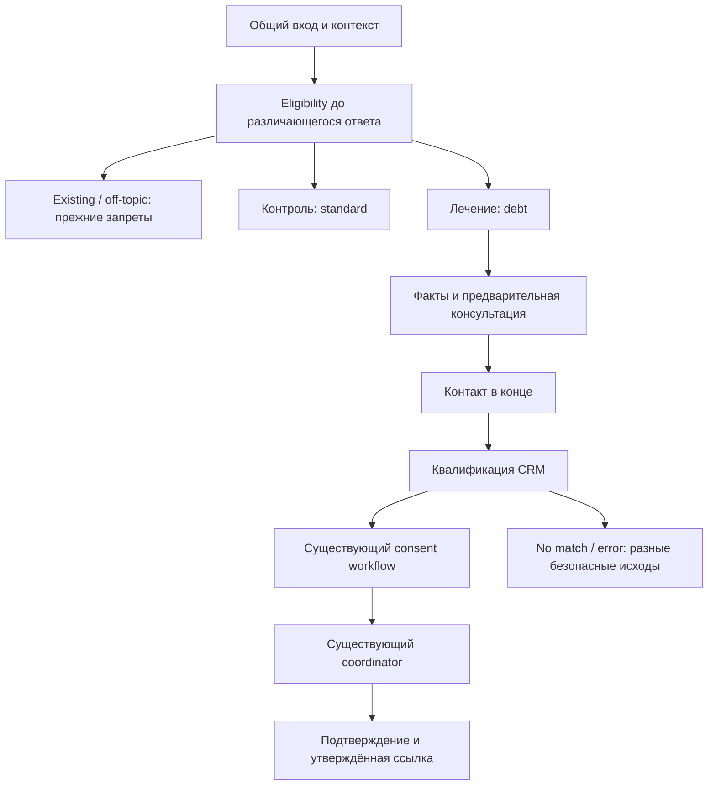

# Долговая консультация МБК — исправленный план работ

Историческая версия 1.1. С 06.11.2026 текущий план —
[версия 2.0](2026-11-06-sites-debt-onloader.md). Изменения: данные сайта и
онлоадер входят в основной объём, отдельная платформа урегулирования пока не нужна.

Дата: 02.11.2026. Версия: 1.1, после критического прохода и серверной сверки.
Статус: предложение. В этой задаче менялась документация; реализация,
сообщения адресатам, production-пилот и A/B не выполнялись.
Критика: [отчёт](2026-11-02-debt-consultation-review.md).
Основание: ответы Михаила 31.10 и локальный checkout dev, HEAD 9e0db4a.
Серверные исходники проверены по четырём закреплённым GitLab SHA —
`СВЕРКА_CRM_И_МАТРИЦЫ_МБК_2026-11-02.md`. Установленная версия приложения,
ответы runtime и действующие значения правил/кампаний БД не проверены.

## 1. Цель, результат и ограничения

Цель — больше подтверждённых CRM лидов с категорией среди людей с долговым
запросом при приемлемой стоимости, задержке и качестве консультации.
Вход: первый запрос клиента, разрешённый контекст страницы, известные факты.
Выход: предварительное объяснение, подтверждённые факты, штатная доставка
лида и оффер CRM либо явный следующий шаг при отсутствии продукта/ошибке.

Согласовано Михаилом: списание и реструктуризация, от 190 тыс. ₽ в БФЛ;
МФЦ пока исключён, урегулирование — запасной вариант; автомобиль, сумму
кредита и возраст можно не спрашивать. Неизвестное авто не означает «нет».
Детали: `docs/agent-memory/facts/debt-branch-scope.md`.

Предложение: один оркестратор и вариант анкеты в действующем ядре.
Замена CRM-классификатора, переписывание бота, новый LLM-провайдер и отдельные
автономные агенты не входят в эту поставку. Получение истории CRM и поиск
реферальных партнёров идут отдельными потоками. Юридическая применимость
не выводится только из суммы, дохода, имущества или старой формулы v3.
Архитектурные изменения перед реализацией оформить ADR со статусом «предложено».

## 2. Очередность, исполнители, условия завершения

| Этап | Что делаем | Исполнитель / зависимость | Проверяемый результат | Оценка |
|---|---|---|---|---|
| 0 | Baseline и контракт короткой анкеты | мы; Андрей — CRM, Михаил — продукт | таблица полей и проверенных payload/response, список открытых блокеров | 1–2 дня + ожидание |
| 1 | Контекст, события CRM и назначение групп | мы; адреса от Михаила | очищенный context, воспроизводимый отчёт, совместимость старого виджета | 1–2 дня |
| 2 | Долговая политика вопросов и фактов | мы; контракт из 0 | отдельный вариант без обнуления долгов и регрессий обычной анкеты | 3–5 дней |
| 3 | Консультация и интеграция доставки | мы; рубрика и CRM из 0 | штатные consent/coordinator, достоверный итог, корректные ошибки | 1–2 дня |
| 4 | Сквозная приёмка | мы + Андрей для их виджета/стенда | корпус, quality gates, браузер и recovery пройдены | 2–3 дня |
| 5 | Согласованная поставка, технический пилот, затем A/B | мы + Андрей + Михаил | доставка и измеримость подтверждены, вывод по протоколу | 1–2 дня проверки + набор выборки |
| R | Черновик реферальной матрицы | мы; партнёры/ссылки с Михаилом | по каждой строке известны статус, владелец и условия активации | отдельная задача |
| H | Read-only история обращений | Андрей + мы | отдельные контракт, права и сквозная приёмка | оценка после доступа |

Критический путь: **0 → 2 → 3 → 4 → 5**. Этап 1 можно начинать рядом с 0,
R и H не блокируют локальную подготовку ветки. Инженерная оценка 0–4:
**8–14 рабочих дней** по строкам таблицы, без внешних ожиданий и эксперимента.
Новый CRM endpoint/новые обязательные поля/новая юридическая логика требуют
переоценки. Это оценка трудоёмкости, не обещание календарной даты.

### Этап 0. Контракт и исходная точка

- [x] Статически сверить валидаторы, mapper, классификатор, router,
  afterIntake/SodaTech, распределение и виджет. Таблица контракта — версия 0.2;
  это подготовительная часть этапа, не сквозная приёмка короткой анкеты.
- [ ] Получить read-only выгрузку активных правил 371, BFL_DEBT_SUMM_SETTING,
  действующих кампаний/лимитов/consent и правил дублей/числа получателей.
- [ ] Согласовать product scope долгового запроса: сейчас отдельного intent
  у классификатора нет, COMMENTS не фильтрует продукты; при отсутствии ёмкости
  возможен каскад к иным продуктам/КЦ. Правдивые факты не удалять ради маршрута.
- [ ] Определить наблюдаемый исход каждой отправки, включая Direct для
  no_category. RF-02 заблокирован до контроля текущих получателей и повторов.
- [ ] Снять сопоставимый read-only baseline после сверки периода, timezone,
  version/build и источников: реальные начавшиеся разговоры, контакты,
  принятые лиды, категория именно CRM, ошибки, обрывы, latency и usage.
  Срезы 29.10 не выдавать за текущие. Открытое окно без реплик — отдельная метрика.
- [ ] Подготовить Андрею запрос и таблицу: business meaning → внутреннее поле →
  Bitrix key/type → omit/null/zero → обязателен ли для qualification/intake →
  пример ответа и ошибки. Сообщение подготовить локально, отправка отдельно.
- [ ] Явно разобрать SUMM, BIRTHDATE, UF_DEBT_SUMM, регион, кредитную историю,
  просрочку, активные кредиты, доход, жильё/ипотеку, авто, продукт и consent.
  Если полю нужны дополнительные вопросы — согласовать; «ровно шесть» не обещать.
- [ ] Проверить профиль 190000–299999 и партнёра sodatech_190, ≥300000,
  Москва/МО/другой регион, отсутствие возраста/авто/суммы кредита и нулевой
  доход. Названия и категории подтвердить по ответам, не только по словарю.
  MIN_DEBT Direct = 190000, верхняя граница — BFL_DEBT_SUMM_SETTING, не
  доказанная константа 300000. Не путать enum партнёра 30300 с категорией.
  Для intake проверить omit/null/число 0/строку "0": ноль обходится фильтрами
  иначе. Qualification использует другой Request и не проверяет intake-фильтр.
- [ ] Получить минимальные fixtures от Андрея/их тестового контура и проверить
  локальные модели/маппинг. Production lead-intake на синтетике не вызывать;
  квалификационные пробы — только согласованный безопасный способ.
- [ ] Михаил утверждает границы консультации, трактовку отказа от продукта,
  коммерческий порог и страницы входа. Не обещать гарантированное сохранение
  имущества, списание или вероятность успеха без валидированной методики.

**Готово:** есть доказанная совместимость обоих запросов, а не только успешная
локальная сериализация. До этого можно писать fixtures/код под выключенным
флагом; production-включение короткой анкеты заблокировано.

### Этап 1. Контекст и измеримость

- [ ] Отделить текущий page-context от исторического landing/UTM. Старое поле
  не переопределять. Приём нового контекста должен работать со старым виджетом.
- [ ] Сохранять разрешённый origin/path и классификацию источника, не полный
  location.href с query/fragment: там бывают fio/телефон и иные ПД.
  form-id — непрозрачный идентификатор, отдельно от analytics/prompt; он
  не подтверждает личность, владение заявкой или право получить историю.
- [ ] Путь страницы — подсказка для сценария. Явный запрос клиента имеет
  приоритет; «взять кредит, чтобы закрыть долг» не включать по одному слову.
- [ ] На фактическом ответе CRM писать отдельное событие: исход, category,
  route/partner при наличии, версии и correlation. Не переименовывать старое
  qualification_completed: сейчас оно описывает локальную матрицу.
- [ ] Связать новый факт с подтверждённым lead_submitted/lead_id. Отличать
  local match, CRM category, no_match, временную ошибку и неизвестный исход.
  Отдельно хранить итоговую доставку: intake возвращает только leadID,
  не получателя/оплату. Прогноз не резервирует ёмкость; категория может
  остаться при маршруте в МБК/КЦ. Assumed_sent SodaTech не равен подтверждению,
  а внутренняя балансовая операция партнёров не равна сверенной выручке.
  Не считать один успех дважды после повторов/восстановления.
- [ ] В событиях: experiment/version, pseudonymous assignment, arm,
  eligibility, exposure, questionnaire version, build/prompt/model/rubric
  versions, шаг, причина fallback, длительности, usage/cost; без текста
  диалога, ФИО, телефона, сырого URL и form-id.
- [ ] Схема событий и запрос отчёта проверены на искусственной локальной БД:
  повторы, category=null, category+неотправленный лид, поздний успех, два окна.
  Новые события добавляются в существующий каталог, не дублируют старые счётчики.

**Готово:** измеряем именно доставку и результат CRM; каждый вывод отчёта
привязан к snapshot/time window/версии запроса, отсутствие данных видно явно.

### Этап 2. Вариант анкеты, состояние, интерпретация

- [ ] Ввести типизированную политику standard/debt: script, initial/contact,
  prerequisites, derivation rules и условие завершения. Имя сейчас initial=true;
  перестановки script недостаточно. Новый выбор применить и в prepare_turn,
  и в replan. Старые сессии без новых полей читаются как standard.
- [ ] В entry.scenario оставить questionnaire/existing/off_topic. Debt —
  вариант внутри questionnaire; запрет лидов в других сценариях сохраняется.
  Eligibility отделить от назначения A/B: допустимый клиент группы A остаётся
  на стандартной анкете, а не автоматически попадает в debt.
- [ ] Убрать наследование ложных предпосылок именно для debt: debts.total
  не зависит от «есть активный кредит». routing/derive.py сейчас подставляет
  ноль при false; просуженные/проданные долги сохраняются и уточняются.
  Изменение глобального поведения standard — только отдельная обоснованная задача.
- [ ] Сумму спрашивать числовой оценкой с обычной money-валидацией. Диапазон
  хранить отдельно; не подставлять в debts.total нижнюю границу/середину.
  Для scalar API уточнить сумму. Границы кнопок, если они останутся:
  <190000 / 190000–299999 / 300000–499999 / ≥500000, без пересечений.
- [ ] Собрать регион и подтверждённо нужные контракту поля. Число объектов,
  наличие ипотеки и желание сохранить имущество — разные признаки.
  Ранее/сейчас проходящее банкротство — контекст консультации по рубрике,
  не безусловный boolean-отказ по старому правилу «пять лет».
- [ ] Не спрашивать запрещённые короткой политикой сумму кредита, возраст,
  авто. Уже добровольно сообщённые валидные данные сохранять с происхождением.
  not_asked / unknown / declined не превращать в false/zero.
- [ ] Разобрать повторные/исправленные ответы и несовпадение фактического
  вопроса с полем плана. pending_question/script.asked/fastpath/extractor
  должны ссылаться на реально заданный вопрос. cad6850 сам по себе
  не закрывает все случаи ухода с плана; общие починки отделить от A/B.
- [ ] Имя и телефон в конце одним запросом; ранний телефон сохранять,
  повторно не выпрашивать. Отказ/непонятный ответ имеет ограниченные попытки.
  Переход debt↔cash возможен до квалификации, сохраняет факты и группу,
  не сбрасывает согласия/отправку; после начатой отправки — recovery policy.

**Готово:** выбор варианта воспроизводим и переживает рестарт; false, unknown
и отсутствующее поле различимы; обычная анкета не меняется скрыто.

### Этап 3. Консультация, CRM, validation/recovery

- [ ] Разделить intent клиента, предварительный консультационный вывод и
  коммерческий маршрут CRM. «БФЛ» не равно судебному заключению о процедуре.
  Наличие имущества не переводит клиента автоматически в кредит/залог.
- [ ] Typed результат: тема, предварительный вывод, основания на известных
  фактах, ограничения, следующий шаг, версия рубрики. LLM отвечает за
  извлечение/формулировку; код — за схему, guardrails, ссылки и переходы.
  Не добавлять новый LLM-вызов на каждый ход или новый провайдер по умолчанию.
- [ ] Сопоставление qualification/intake — из одинаковых фактов и функций.
  Проверить семантику omit/null у API: сейчас qualification сериализует null,
  lead-intake исключает None. Не менять сериализацию глобально без контракта.
- [ ] Использовать существующие CrmDialogWorkflow и LeadIntakeCoordinator,
  gate/claim/consent и recovery; не создавать второй путь отправки.
  Проверить, что check_second_realty не удлиняет debt залоговыми вопросами.
- [ ] Успех/no_match/error/OUTCOME_UNKNOWN дают разные тексты. category=null
  не является техническим отказом и само по себе не отменяет допустимый лид.
  Таймаут квалификации можно обрабатывать штатным bounded retry; после
  таймаута lead-intake не повторять POST без установленного безопасного исхода.
- [ ] Сначала существующий consent workflow, затем штатная отправка.
  thanks_url CRM и партнёрский fallback — разные типы ссылок. Не подменять
  страницу согласия; незнакомый URL не принимать от модели. Отправлено —
  только после подтверждённого результата, не после намерения клиента.
- [ ] При отсутствии продукта показывать утверждённую подсказку. Referral
  активен только при подтверждённой строке матрицы; иначе честный следующий
  шаг без выдуманной ссылки. Ошибка CRM не маскируется как отсутствие продукта.

**Готово:** по локальным integration fixtures один допустимый лид, корректное
согласие, восстанавливаемые состояния и отсутствие ложных обещаний.

### Этап 4. Приёмка и критерии качества

- [ ] Baseline/regression standard, entry scenarios, fastpath, семантический
  извлекатель и legacy fallback, планирование и сериализация состояния.
- [ ] Граничные суммы 189999/190000/299999/300000/499999/500000; нечисловая
  сумма, интервал через границу, неизвестный регион, нулевой доход,
  отсутствие возраста/авто, долг без активного кредита, старые факты =0.
- [ ] Жильё: нет/один/несколько × ипотека да/нет/неизвестно; фразы «мой»,
  «первая», «нет» после уточнения; повторное банкротство без авто-решения.
- [ ] Ранний телефон, отказ, существующий клиент, смена цели, prompt injection,
  выдуманная ссылка, чужой form-id, поддельный page-context, ПД в query.
- [ ] Timeout/5xx/schema error/no_match, перезапуск на consent и отправке,
  двойной клик, повтор SSE, два процесса. Проверять отсутствие дополнительного
  POST и сохранение реального исхода, а не только возвращённый статус.
- [ ] Отдельный обезличенный корпус: явный debt, cash для погашения долга,
  неясные и повторные запросы. Метки владельца продукта; отложенная выборка
  не используется для настройки промпта. Отчёт по группам, не одна accuracy.
- [ ] Критические нарушения на приёмочном корпусе = 0: выдуманные факты,
  ложное подтверждение лида/согласия, юридические гарантии, непроверенная ссылка,
  потерянный подтверждённый долг, лишний POST. Это условие корпуса, не гарантия
  отсутствия всех будущих ошибок. Граница качества intents — принятая рубрика
  и парная оценка со standard; спорные примеры разбирает человек.
- [ ] Сквозная проверка настоящего site_widget с backend на стенде, SSE,
  кнопки, восстановление и телефон. Наш frontend не заменяет виджет заказчика.
- [ ] Приложить eval artifact: commit, конфигурация без секретов, версии
  данных/модели/промпта, command, seed где применим, ошибки и ограничения.

**Quality gates будущих Python-правок:**

```powershell
.venv313/Scripts/python -m ruff check .
.venv313/Scripts/python -m pyright
.venv313/Scripts/python -m pytest
```

Ruff/pytest доступны. pyrightconfig.json существует, режим basic, pythonVersion
3.12; requirements-dev фиксирует pyright. Модуль восстановлен 02.11.2026,
проверка проекта выполнена без ошибок; AGENTS.md актуализирован.
Перед следующими правками проверять штатное dev-окружение и соответствие
версии Python. Не подменять конфиг и не объявлять
type gate пройденным без запуска. Новые зависимости без обоснования не добавлять.
Для site_widget: npm test в его каталоге после установки по package-lock;
для frontend — фактические команды package.json, только если он меняется.
Структурная миграция БД — лишь если state JSON недостаточно; тогда по реальному
механизму миграций проекта, с обратимостью и проверкой данных. Наличие Alembic
не предполагается. Для текущей задачи документации Python-тесты не требуются.

### Этап 5. Релиз и A/B

- [ ] До эксперимента сверить установленные исправления и MR !12. Общие
  починки включить одинаково в A и B, стабилизировать общий релиз.
  Изменение CRM-правил во время теста фиксировать как смену условий;
  существенное изменение требует нового периода/версии эксперимента.
- [ ] Backend принимает новый context первым, новые флаги выключены по
  умолчанию. Затем совместимый виджет заказчика; сборка/выкатка через Андрея.
  Перед синком перенести изменения заказчика и сверить актуальные blob/файлы;
  новые корневые модули включить в Dockerfile/поставочный список. Его CI и
  статус нынешнего MR проверяются заново; старые сообщения не доказательство.
- [ ] Локальную release.py не считать поставкой в production заказчика.
  Push/MR, сообщения и включение трафика — по отдельному текущему разрешению.
  Аналитика production — только чтение; синтетические лиды не создавать.
- [ ] Технический пилот с ограниченным разрешённым трафиком проверяет
  доставку/consent/ошибки/телеметрию, не прирост конверсии. Порог охвата,
  длительность и guardrails фиксируются с владельцем до включения.
- [ ] Потом A/B 50/50 в согласованной eligible-когорте: одинаковое поведение
  до начала различающихся ответов. Eligibility — известная страница или
  первый запрос до воздействия варианта; не отбор по завершению анкеты.
- [ ] Единица — псевдонимный браузер, не «уникальный человек». Server-side
  cookie/назначение сохраняется между сессиями, не заменяет session grant.
  Версии, assignment, фактическая exposure и аварийный fallback фиксируются.
  Старые сессии без назначения не подмешиваются в контроль автоматически.
- [ ] Основная метрика: доля назначенных eligible-браузеров, у которых
  после начала диалога в фиксированном окне есть хотя бы один подтверждённый
  lead_id с категорией именно CRM. Не более одного успеха на единицу;
  повторные сессии объединяются, ошибки/fallback остаются в назначенной группе.
  Результат именовать «категоризированный принятый лид», не «оплаченный лид».
- [ ] Окно результата, например 72 часа, утвердить до старта по реальной
  задержке consent/intake; сравнивать созревшие когорты. Контроль дисбаланса
  групп, источников, неизвестных назначений и потерь событий обязателен.
- [ ] Дополнительно: контакт/завершение, доля CRM no_match/error, повторы,
  p50/p95 хода и всего диалога, стоимость на начатый разговор/принятый лид.
  Клики и оплаченные лиды — только при наличии соответствующего источника
  данных; CRM-категория не заменяет оплату. Не заводить их из предположений.
- [ ] До старта записать baseline p0, минимально полезный эффект, alpha/power,
  требуемый размер и max-duration. Иллюстрация, не реальные данные МБК:
  15%→20%, alpha .05 и power .8 требуют примерно 906 независимых единиц на
  группу по нормальному приближению. 14 дней — первый диагностический срез,
  при малой выборке результат «данных недостаточно», без выбора победителя.
- [ ] Критические нарушения consent/ПД/дубли/ложный успех → остановка пилота.
  Числовые лимиты latency/cost/error задать по этапу 0 до запуска. Их
  отсутствие блокирует запуск, не заменяется обещанием «посмотрим потом».
  Ежедневный мониторинг здоровья не является ежедневным тестом значимости.
- [ ] Цены моделей, latency/cost и бюджеты брать из текущего baseline,
  не из старой оценки Jev или исторических $35. До утверждения числовых
  бюджетов не заявлять, что MVP выдерживает production SLO.
- [ ] Отключение: запретить новые debt-назначения, действующие сессии завершать
  на закреплённой версии. Аварийная остановка доставки/консультации сохраняет
  состояние и безопасный текст; неизвестный исход POST не повторяется вслепую.
  Проверить rollback и чтение новых состояний старой/совместимой версией.

**Готово:** получен протокольный вывод: улучшение / ухудшение / данных
недостаточно, с интервалом неопределённости и проверкой guardrails.
Эксперимент оценивает весь пакет новой анкеты. Отдельный эффект переноса
контактов этим тестом не доказывается; для него нужен самостоятельный тест.

## 3. Контракты и переходы предлагаемого решения

| Контракт | Ключевые поля | Кто принимает решение |
|---|---|---|
| EntryContext | разрешённые origin/path, source class, observed_at | серверная policy; URL не даёт прав |
| QuestionnaireContext | standard/debt, version, reason, effective policy | детерминированный селектор |
| DebtAmountEvidence | scalar/interval/unknown, bounds, source, confirmation | money-validator и уточнение |
| ConsultationResult | subject, preliminary outcome, evidence, limitations, next step, rubric version | LLM формулирует, код/рубрика проверяют |
| CrmOutcome | success/no_match/error/unknown, category, route, consent, link | фактический ответ CRM |
| ExperimentAssignment | experiment/version/arm, browser key, eligibility, exposure, fallback | серверное назначение |

Pydantic на границах, без новых библиотек. State в существующем session state;
постоянного retrieval/RAG или новой «памяти» для MVP не требуется.
Нельзя смешивать prompt construction, invocation, parsing и validation.



Debt-state: collecting → contacts → crm_qualification → awaiting_consent,
если CRM требует → submission_pending → submitted. Rejected/no_match/error/
unknown-outcome различаются; их конкретные статусы брать из нынешних enum,
а не создавать параллельный CRM-автомат. No_match продолжает допустимый
lead-intake по нынешнему контракту; error не превращается в no_match.

## 4. Карта модулей для реализации

| Слой / существующие точки | Предлагаемая работа |
|---|---|
| routing/schema.py, matrix.yaml, planner.py, derive.py | версия policy варианта, script/initial/prerequisites/derivation; прежние route rules не копировать |
| questionnaire_policy.py — новый, имя предварительное | типизированный выбор effective policy, чистые переходы, без I/O и промптов |
| state.py, core.prepare_turn/replan/commit_turn | хранение версии и применение одной policy ко всем путям пересчёта |
| interpretation/contracts.py, fastpath.py, extractor prompt | понимание debt/числовых оценок и новых фактов в прежнем pipeline, проверка схемы |
| assistant_contracts.py, prompts.py | предварительный результат и тон по утверждённой рубрике, без коммерческих правил в промпте |
| delivery/crm_contracts.py, crm_mapping.py, contracts.py | доказанная семантика пропусков, продуктовые метки и одинаковые qualification/intake |
| crm_dialog_workflow.py, lead_intake_coordinator.py | вариант в старом consent/recovery/claim, без второго отправителя |
| main.CreateSessionBody, session_store.py, attribution.py, site_widget | отдельный очищенный контекст, устойчивое назначение, совместимость старого API |
| analytics/events.py, точка приёма CRM-ответа, evaluation | реальные CRM outcomes, exposure и отчёт без ПД, воспроизводимый корпус |
| tests и site_widget/test | поведенческие и контрактные проверки по этапу 4 |

Окончательные имена новых полей/файлов закрепить в ADR перед кодом. Добавление
housing_count/mortgage требует проверки всех закрытых схем, нормализаторов,
сериализации и публичного lead-контракта, не только строки в YAML.

## 5. Самостоятельные потоки R и H

**R — реферальная матрица.** Начать с таблицы: проблема клиента → известные
условия → кандидат решения → партнёр → регионы/порог → destination URL →
модель оплаты/дедупликация → нужное согласие → владелец → статус проверки.
Нет партнёра/условий — строка draft, ссылка не показывается. Михаил помогает
искать/утверждать. Урегулирование после отказа человека от списания/рестракта
не равнозначно error CRM или отсутствию категории — эти причины раздельны.

**H — история CRM.** Сначала contract/read-only view или API: входной ключ,
авторизация и scope, допустимые статусы, давность, маскирование, timeout,
аудит, ограничение частоты. Телефон/form-id сами не дают право показать
историю в публичном чате. До реализации и согласования сохраняем действующую
политику existing без второго лида. Отдельно согласовать просьбу перезвонить,
передачу оператору и дедупликацию. Голосовой бот — отдельная интеграция.

## 6. Ближайший исполнимый пакет

1. Подготовить таблицу вопросов/fixtures Андрею и список ожидаемых ответов.
2. Зафиксировать baseline-запрос и словарь событий; проверить на локальных данных.
3. Подготовить ADR и приёмочные кейсы debt-policy, включая неактивные кредиты
   с оставшимся долгом и отличия scalar/interval.
4. Собрать черновик матрицы R без активных непроверенных ссылок.

Пункт 4 выполнен 02.11.2026 как документация:
`docs/v5/РЕФЕРАЛЬНАЯ_МАТРИЦА_2026-11-02.md`, версия 0.2 после сверки серверного кода.
Утверждение гипотез/партнёров и подключение ссылок ещё не выполнены.

02.11 также подготовлена локальная часть пункта 1:
`docs/v5/КОНТРАКТ_ДОЛГОВОЙ_АНКЕТЫ_2026-11-02.md` и восемь запросов
`docs/v5/debt_qualification_requests_2026-11-02.json`.
Они валидны по локальной схеме; статическая проверка серверных исходников
добавлена в контракт v0.2. Ответы backend и правила из БД ещё не получены.
Пакет сообщений и очередь: `СЛЕДУЮЩИЕ_ШАГИ_МБК.md`, ничего не отправлено.
Пункт 1 целиком и этап 0 не закрыты: нужны внешние подтверждения и baseline.

Оперативная часть baseline восстановлена и выполнена 02.11: CLI
`analytics.production_leads`, инструкция `ПРОВЕРКА_ЛИДОВ_МБК.md`, срез
`ОТЧЁТ_ЛИДЫ_2026-11-02.md`. Полный baseline A/B/исторические CRM-категории
этим ещё не закрыты; категория доступна только в сохранившихся сессиях.

Это следующий пакет реализации после данного планирования. Внешние ответы
проверяются до зависимых операций; план не выдаёт их за уже полученные.
